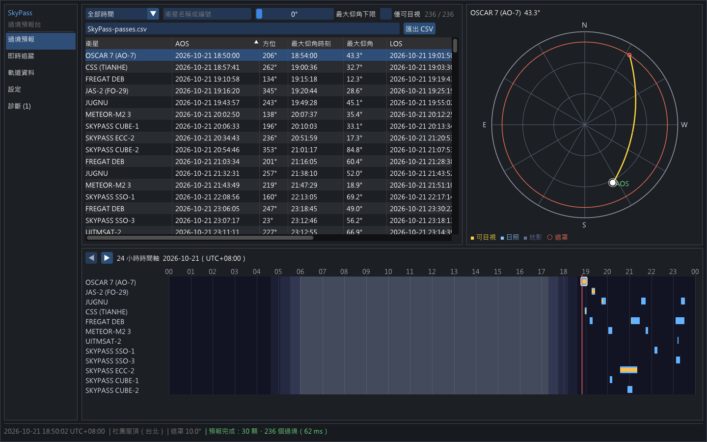
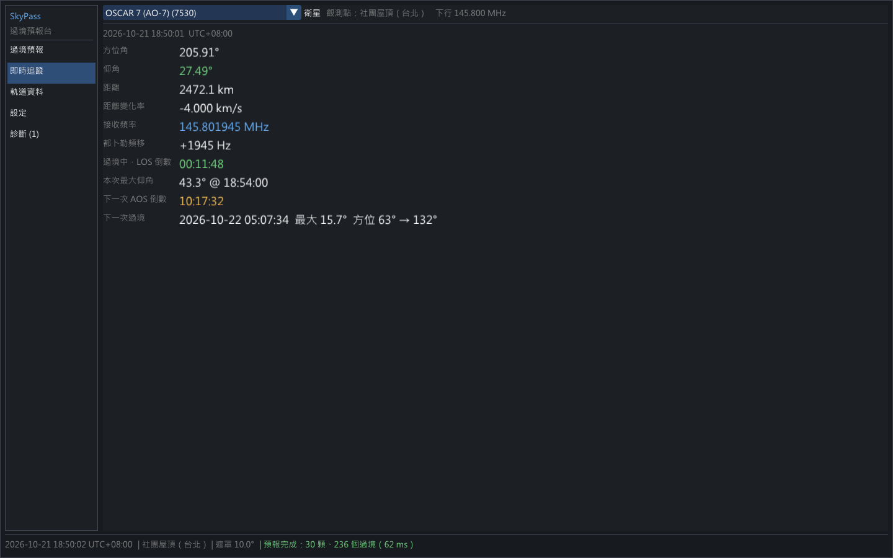
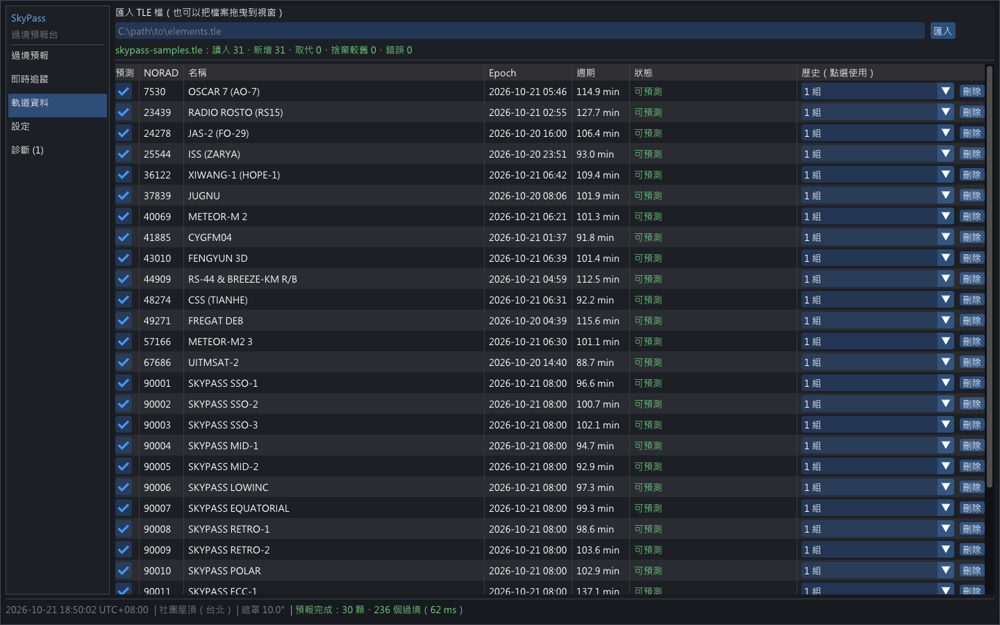
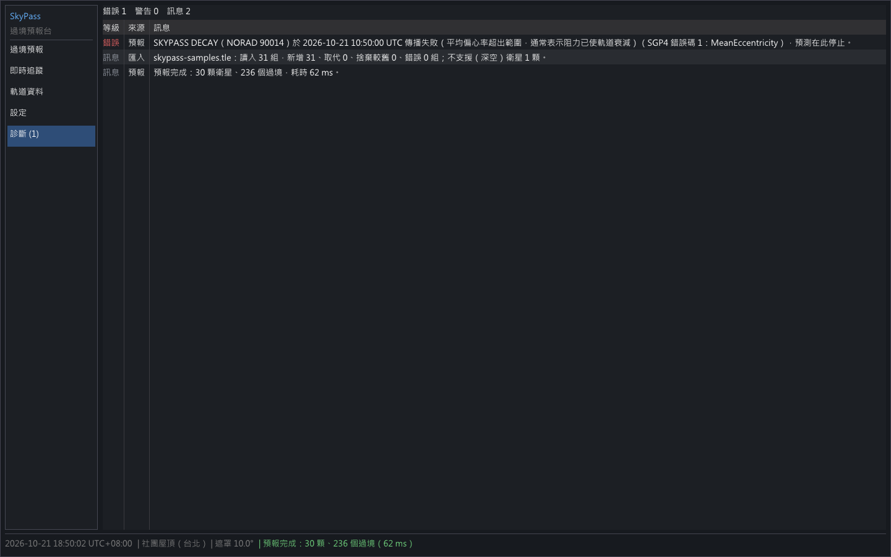
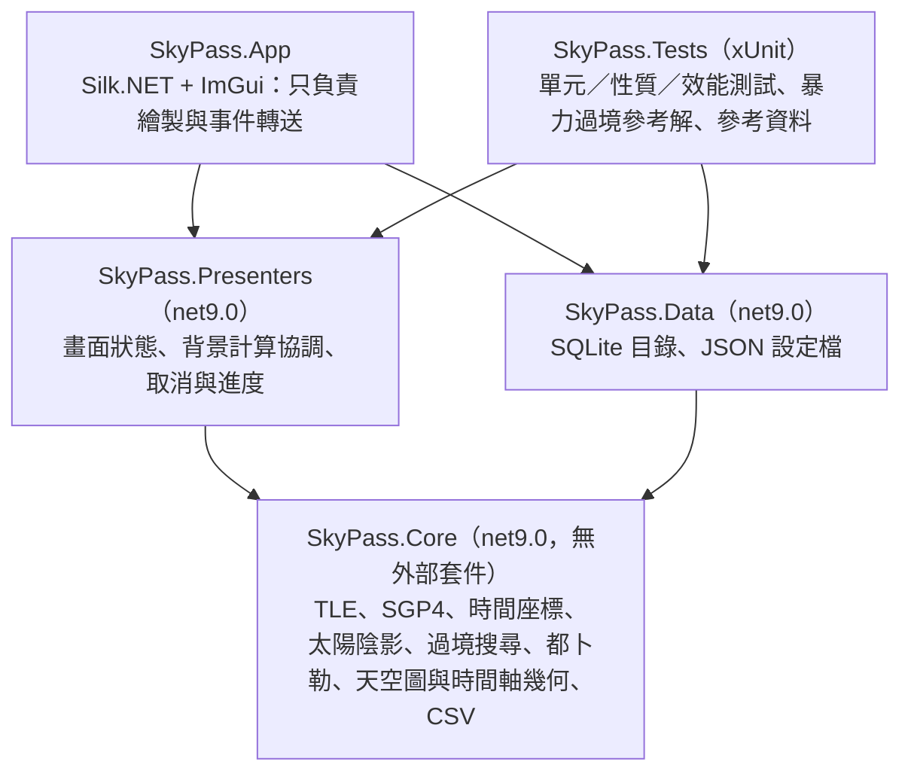

# SkyPass 過境預報台

[](https://github.com/hn83320589/SkyPass/actions/workflows/ci.yml)

給業餘無線電社團使用的**離線**衛星過境預報桌面工具：匯入 TLE 後，自行實作的 SGP4 預報過境、
畫出天空圖與 24 小時時間軸、計算都卜勒頻移與可目視時段，並提供每秒更新的即時追蹤。
不呼叫任何網路服務，軌道資料由使用者自行下載後匯入。

- **平台**：Windows，C# / .NET 9，Silk.NET（視窗與 OpenGL 3.3）+ ImGui.NET
- **SGP4**：自行實作（Vallado 2006 近地分支），與參考實作逐點相符（位置 ≤ 1e-6 km、速度 ≤ 1e-9 km/s）
- **測試**：360 個 xUnit 案例（含 16 組固定種子的隨機性質測試），獨立的暴力過境參考解；完整結果見[測試報告](docs/TEST-REPORT.md)

## 目錄

[功能](#功能) · [截圖](#截圖) · [建置與執行](#建置與執行) · [架構](#架構) · [演算法](#演算法) ·
[測試](#測試) · [參考資料的產生方式](#參考資料的產生方式) · [效能數據](#效能數據) ·
[設計取捨](#設計取捨) · [已知限制](#已知限制) · [驗收標準對照](#驗收標準對照)

## 功能

| 畫面 | 內容 |
|---|---|
| **過境預報** | 過境表（依衛星／AOS／最大仰角排序，依名稱、時間範圍、最大仰角下限、僅可目視篩選）、天空圖、24 小時時間軸，三者點選聯動；匯出 CSV |
| **天空圖** | 極座標（北在上、東在左、天頂在圓心），軌跡依「可目視／日照／地影」著色，遮罩圈、目前位置 |
| **時間軸** | 各衛星的過境區段（可目視部分以黃色標示），疊上白天、民用／航海／天文曙暮光與夜晚色帶；目前時刻紅線 |
| **即時追蹤** | 每秒更新方位角、仰角、距離、距離變化率、接收頻率、都卜勒頻移、AOS／LOS 倒數 |
| **軌道資料** | 匯入 TLE（路徑或拖曳），錯誤組別列出行號與原因；每顆衛星保留最近 5 組歷史、可釘選；深空軌道標示「不支援」，epoch 相差 14 天以上標示「陳舊」 |
| **設定** | 觀測點最多 5 個（高度以公尺輸入）、遮罩（預設 10°）、預報天數、下行頻率、畫面與 CSV 的時區偏移（預設 UTC+8） |
| **診斷** | 匯入錯誤、衰減停止、陳舊警告、資料庫或設定檔問題 |

預報在背景平行計算，可取消並顯示進度；取消後保留上一次的完整結果，不會出現半套結果。

## 截圖

以 `samples/skypass-samples.tle` 與固定時刻 2026-10-21 18:50（UTC+8）擷取（重現方式見[命令列參數](#命令列參數)）。

| 過境預報（過境表＋天空圖＋時間軸） | 即時追蹤 |
|---|---|
|  |  |
| **軌道資料** | **診斷**（構造的高阻力衛星在預報前已衰減） |
|  |  |

設定頁：[docs/screenshots/settings.png](docs/screenshots/settings.png)

## 建置與執行

需要 Windows 與 [.NET 9 SDK](https://dotnet.microsoft.com/download/dotnet/9.0)（9.0.x）。

```powershell
dotnet build SkyPass.sln                         # 建置（含 App）
dotnet test SkyPass.sln                          # 全部測試（約 25 秒）
dotnet test SkyPass.sln -c Release --filter Category=Performance   # 只跑效能測試
dotnet run --project src/SkyPass.App             # 執行
dotnet publish src/SkyPass.App -c Release -r win-x64 --self-contained -o publish/win-x64
```

第一次執行時請到「軌道資料」頁匯入 TLE（例如從 CelesTrak 下載的 `.tle` 檔，或本專案的 `samples/skypass-samples.tle`），
也可以直接把檔案拖曳到視窗。資料庫與設定檔位於 `%LocalAppData%\SkyPass\`。

介面使用 Windows 內建的微軟正黑體（`C:\Windows\Fonts\msjh.ttc`）；找不到時改以英文顯示介面。

### 命令列參數

| 參數 | 說明 |
|---|---|
| `--data <目錄>` | 改用指定目錄存放資料庫與設定檔 |
| `--import <TLE 檔>` | 啟動後匯入 |
| `--now <ISO 8601 UTC>` | 以指定時刻為「現在」（之後照實際時間前進） |
| `--screenshot <目錄>` | 預報完成後擷取各頁為 PNG 並結束 |

README 的截圖即由下列指令產生：

```powershell
SkyPass.App.exe --data %TEMP%\skypass-shot --import samples\skypass-samples.tle --now 2026-10-21T10:50:00Z --screenshot docs\screenshots
```

### CI

`.github/workflows/ci.yml` 在 `windows-latest` 以 `setup-dotnet` 9.0.x 建置全部專案（含 App）、執行測試、
上傳測試結果，並把 `win-x64` self-contained 發佈檔上傳為 artifact `SkyPass-win-x64`。

## 架構



- **Core** 不引用任何 UI、OpenGL、Windows 專用組件或第三方套件；儲存介面（`ITleCatalogStore`、`ISettingsStore`）也定義在 Core，由 Data 實作。
  分層由 `LayeringTests` 以反射檢查。
- **Presenters** 只依賴 Core，測試時用記憶體中的假儲存與 `FakeTimeProvider`。所有「現在時間」都透過 `TimeProvider`。
- **App** 是 composition root：建立儲存、`MainPresenter` 與視窗，每幀呼叫 `MainPresenter.Update()` 後繪製；
  天空圖、時間軸的所有座標、刻度、DPI 取整都由 Core 計算，App 只把點連成線。

### 執行緒模型

```
UI 執行緒（每幀）                                  背景（Task.Run / Parallel.For）
──────────────────────────────────                ────────────────────────────────
MainPresenter.Update()
  ├ 目錄／觀測點／遮罩改變？→ PredictionPresenter.StartAsync ─► PassPredictor.Predict
  │                                                            （以衛星為單位平行，取消時擲 OCE）
  ├ 讀 PredictionState 快照（Volatile）◄────────────────────── 完成時一次發佈完整結果
  ├ 新結果 → PassTable、Timeline、Diagnostics
  └ 選取改變 → SkyPlot、Timeline、LiveTracking ──────────────► 即時追蹤的過境快取（24 h）
App 繪製（只讀快照）
```

背景工作只發佈**不可變快照**；跨畫面的傳遞都在 UI 執行緒的 `Update()` 中以版本號比對完成，
不需要 SynchronizationContext，也讓 Presenter 能在測試中同步驅動。

### 專案內容

| 專案 | 主要型別 |
|---|---|
| Core | `TleParser`／`TleFormatter`／`TleCatalog`、`Sgp4Propagator`、`JulianDate`／`Gmst`、`Frames`／`Wgs84`／`ObserverSite`／`Observation`、`SunPosition`／`Shadow`／`ShadowSearch`、`PassFinder`／`PassPredictor`、`VisibilityCalculator`、`DopplerCalculator`、`SkyPlotLayout`／`SkyTrack`、`TimelineGeometry`／`DpiScaler`、`PassCsvExporter` |
| Data | `SqliteTleCatalogStore`、`JsonSettingsStore`、`AppPaths` |
| Presenters | `MainPresenter`、`PredictionPresenter`、`PassTablePresenter`、`SkyPlotPresenter`、`TimelinePresenter`、`LiveTrackingPresenter`、`CatalogPresenter`、`SettingsPresenter`、`DiagnosticsPresenter` |
| App | `AppHost`、`Views/*`、`ScreenshotScript`、`PngWriter` |

## 演算法

各公式的逐步數值範例見 [docs/hand-calculations.md](docs/hand-calculations.md)（時間、GMST、座標、都卜勒、陰影各 10 組）。

### TLE

逐組驗證行長度（69）、行號、校驗碼（數字取值、負號計 1、其餘 0，總和取個位數）、各欄位格式與範圍；
錯誤組別回報**檔案實際行號**與原因後跳過，其餘照常匯入。偏心率為隱含小數點的 7 位數字；
BSTAR 與二階項為「符號、5 位尾數、符號、1 位指數」，數值以 `尾數 × 10^指數` 計算——與 Vallado `twoline2rv` 相同的運算順序，
確保 SGP4 的輸入與參考實作逐位元一致。epoch 年份 57–99 為 19xx、00–56 為 20xx。

### SGP4

逐行移植 Vallado 等人（2006）〈Revisiting Spacetrack Report #3〉C++ 參考實作（python-sgp4 2.27 所附 `SGP4.cpp`）的近地分支：
WGS-72 常數、opsmode `'i'`、近地點 < 220 km 時 `isimp = 1`（省略 d2–d4 與 t3–t5 項）。

- 原碼在 `sgp4()` 中會寫回 `satrec` 的平均元素；移植時全部改為區域變數，**初始化後物件不可變**，因此執行緒安全，
  熱路徑只用 `readonly struct`（`Vector3d`、`TemeState`），**零配置**。
- 失敗時回傳與參考實作相同的錯誤碼（1 平均偏心率、2 平均運動、4 半正焦弦、6 衰減），不擲例外；
  週期 ≥ 225 分鐘回傳 `DeepSpaceNotSupported`。
- `tsince = ((JD − JD_epoch)_日 + (JD − JD_epoch)_小數) × 1440`。

### 時間與座標

- **兩段式儒略日**（`JulianDate` = 當日 0h + 日內比例）。單一 double 的儒略日解析度約 40 µs，會讓 GMST 誤差達約 3e-9 rad，
  超過 1e-9 rad 的要求；兩段式與 Vallado／python-sgp4 的 `jd, fr` 相同。格里曆換算使用 Fliegel–Van Flandern 整數演算法（2100 非閏年正確）。
- GMST（IAU-82）、TEME → 地固（含 ω × r 速度項）、WGS-84 大地 → 地固、站心 S/E/Z 與方位角、仰角、距離、距離變化率，全部依假設事項。
- 另以解析式提供**仰角變化率** dEl/dt = (Ż·|ρ| − Z·ρ̇) / (|ρ|²·cos El)，不需額外傳播，供過境搜尋偵測極值。

### 過境搜尋（`PassFinder`）

1. **全域對齊的取樣格點**：取樣時刻為 1970-01-01 起每 30 秒的整數倍，再加上時間範圍的起訖點。
   把 [t0, t2] 拆成 [t0, t1] 與 [t1, t2] 時，兩次預測用到的樣本與一次預測相同，因此**視窗拆分不變**。
2. 每個樣本計算 f = 仰角 − 遮罩與解析的 f'。
3. f 變號 → AOS 或 LOS，二分法求到 1 毫秒。
4. **避免漏掉掠過過境**：只看 f 的符號，會漏掉「兩個取樣點都在遮罩下、中間短暫升起」的過境。
   因此同時看 **f' 由正轉負**——代表區間內有仰角極大值——二分求 f' 的根得到極大值；若極大值 ≥ 遮罩，
   就在 [a, t_max] 與 [t_max, b] 各求一次跨越點，得到這次掠過過境的 AOS/LOS。
   只有在一個 30 秒取樣間隔內同時出現極大與極小值時才可能漏判；近地軌道相鄰的仰角極值相隔數十分鐘，遠大於 30 秒。
   這個論點由 320 組隨機情境與逐秒暴力參考解的比對，以及 60 組「最大仰角只比遮罩高 0.05°–0.5°」的構造案例驗證。
5. 起點時已在遮罩上 → AOS = 起點、標示「起點前已開始」；終點同理。最大仰角取時間範圍內的最大值。
6. 傳播失敗 → 二分出失敗時刻（0.5 秒內），停止並產生診斷。

**多顆衛星**（`PassPredictor`）以衛星為單位 `Parallel.For`；每顆衛星的計算是循序且決定性的，結果寫入索引陣列後依（AOS, NORAD）穩定排序，
所以 1 與 N 個執行緒的結果**逐位元相同**。取消時擲出 `OperationCanceledException`，不回傳任何部分結果；進度以鎖序列化，保證單調遞增。

### 日照、可目視與都卜勒

- 太陽位置採低精度公式；圓柱陰影以連續的邊界函數（r·ŝ < 0 側為 |r⊥| − Re，否則 |r| − Re）每 10 秒取樣、二分到 1e-4 秒求進出時刻。
- 可目視 = 過境期間「受日照」且「太陽仰角 < −6°」：兩個連續函數各自求根後合併區段，總長不足 1 秒不標示。
- 接收頻率 = f0 × (1 − ṙ / c)；接近時 ṙ < 0、頻率升高。

### 天空圖與時間軸幾何

- 天空圖：r = R·(90° − El)/90°，x = cx − r·sin Az，y = cy − r·cos Az（螢幕 y 向下，北在上、東在左）。
  軌跡先每 10 秒取樣，再把畫面距離大於 3 像素的區段對半細分。
- 時間軸：x = x0 + 寬 × (t − 起點) / 24 h；以顯示時區的午夜為起點；晝夜色帶依太陽仰角 0°、−6°、−12°、−18° 分段。
- DPI：每個座標由精確的邏輯座標乘上倍率後**各自**四捨五入，不累加取整後的間距，因此沒有累積誤差，相鄰區段共用同一條邊。

## 測試

`dotnet test` 共 360 個案例，全部通過；逐項驗收檢查、規格限制檢查與量測細節見 [docs/TEST-REPORT.md](docs/TEST-REPORT.md)。

- **性質測試**（16 組，`Property.Run`，固定種子；失敗時訊息列出可用 `Property.Replay(caseSeed)` 重現的種子）：
  UTC↔JD 往返與時間單調性、TLE 往返（格式化→解析→格式化）、目錄歷史規則、大地↔地固往返、TEME→地固保長、
  仰角變化率 ≈ 數值微分、**過境集合與暴力參考解一致**、掠過過境不漏、**視窗拆分不變**、過境屬性、**遮罩提高時集合單調縮小**、
  **結果與執行緒數無關**、**單位換算**、天空圖投影、時間軸映射往返、DPI 取整無縫。
- **暴力過境參考解**（`tests/SkyPass.Tests/Reference/BruteForcePassFinder.cs`）：從視窗起點**逐秒**取樣仰角，二分法求 AOS/LOS，
  黃金分割求最大仰角。它只共用傳播與座標轉換（`Observation.Compute`），**不引用 `SkyPass.Core.Passes` 的任何程式碼**，
  不使用仰角變化率，也不依賴取樣格點對齊——與正式演算法互相獨立。
- **效能測試**（`Category=Performance`）：100 顆 × 7 天預算、SGP4 與觀測計算零配置、即時追蹤單次更新 ≤ 1 ms。
  2 秒的預算以 8 核心為準；在核心數較少的機器（例如 CI runner）依比例放寬並在輸出記錄實測值。

## 參考資料的產生方式

所有參考資料由 [`tools/refgen`](tools/refgen/README.md) 的 Python 腳本**離線**產生並提交；正式程式與 CI 不需要 Python。

| 項目 | 版本／來源 |
|---|---|
| Python | 3.11.9 |
| [python-sgp4](https://pypi.org/project/sgp4/) | **2.27**（C++ 加速版，即 Vallado 官方 `SGP4.cpp`；腳本會檢查 `sgp4.api.accelerated`） |
| 已發表驗證案例 | Vallado 等人（2006）`SGP4-VER.TLE` 與 `tcppver.out`（取自 python-sgp4 2.27 原始碼套件） |
| 真實 TLE | 2026-10-21 CelesTrak 快照 14 顆（`tools/refgen/inputs/`） |

- **SGP4**：`SGP4-VER.TLE` 只有 9 組近地案例，因此再加入 14 顆真實衛星，共 23 組，涵蓋近圓／高偏心率、低／高傾角、極低近地點、逆行與衰減；
  期望值以 `sgp4_tsince` 完整精度產生，另與 `tcppver.out` 在其列印精度內交叉比對。隨機參考資料為 320 組近地軌道 × 6 個時間點。
- **時間與 GMST**：以 Python `decimal`（60 位有效數字）計算。
- **座標、太陽、陰影、都卜勒、即時追蹤、預期過境表**：衛星狀態取自 python-sgp4，其餘依假設事項的公式在 Python 中獨立實作。

## 效能數據

量測環境：Intel Core i7-13700（24 個邏輯處理器）、Windows 11、.NET 9.0、Release 建置。

**100 顆衛星 × 7 天 × 遮罩 10°（含可目視計算，2955 個過境）**

| 執行緒 | 耗時 |
|---:|---:|
| 1 | 2640 ms |
| 2 | 1310 ms |
| 4 | 748 ms |
| 8 | **354 ms**（驗收要求 ≤ 2 秒） |
| 24 | 135 ms |

| 項目 | 數值 |
|---|---|
| SGP4 單次呼叫 | 約 700 ns，**0 bytes** 配置（400 萬次呼叫量測） |
| 傳播 + GMST + TEME→地固 + 站心觀測 | 約 1.0 µs，0 bytes |
| 即時追蹤單次更新 | 中位數 1.2 µs，P99.9 3.0 µs，5000 次中最大 47.6 µs（要求 ≤ 1 ms） |
| 範例資料 30 顆 × 2 天（App 內） | 約 70 ms |

重現：`dotnet test -c Release --filter Category=Performance --logger "console;verbosity=detailed"`。

## 設計取捨

| 決策 | 理由 | 代價 |
|---|---|---|
| 兩段式儒略日 | GMST 必須 ≤ 1e-9 rad，單一 double 不夠 | API 多一個型別 |
| SGP4 逐行照抄運算順序，不重構 | 位置 1e-6 km、速度 1e-9 km/s 的比對要求浮點結果與參考實作一致 | 程式碼風格貼近 C，可讀性較低 |
| 不可變的傳播器 | 執行緒安全、零配置、平行預報不需鎖 | 與原碼結構不同，需要逐一確認被寫回的欄位 |
| 全域格點 30 秒 + 解析仰角變化率 | 簡單、決定性、天然滿足視窗拆分不變；以導數抓掠過過境 | 依賴「30 秒內不會同時出現仰角極大與極小」的假設（近地軌道成立，以暴力參考解驗證） |
| 快照 + 每幀 `Update()` 聯動 | ImGui 本來就每幀重畫；Presenter 可同步測試，不需 SynchronizationContext | 每幀做版本號比對（成本可忽略） |
| 預報以衛星為平行單位，完成才發佈 | 結果與執行緒數無關、取消不留半套結果 | 單顆衛星很長的預報無法再細分平行 |
| SQLite 保存 TLE 原文，整個目錄以單一交易覆寫 | 往返無損、實作簡單；社團的目錄只有數百筆 | 目錄非常大時寫入較慢 |
| 自寫性質測試工具、`FakeTimeProvider`、PNG 編碼器 | 不引入額外套件 | 功能較陽春（沒有自動縮小反例） |
| 系統字型而非打包字型 | 不增加發佈檔大小、沒有字型授權問題 | 非中文 Windows 可能缺字（改英文介面） |
| 天空圖軌跡在 UI 執行緒計算 | 一次約數百次傳播（< 1 ms），只在選取或視窗大小改變時重算 | 極端情況下可能有一幀延遲 |

## 已知限制

- **不支援深空軌道**（週期 ≥ 225 分鐘，如 GEO、GPS、Molniya）：只實作 SGP4 近地分支，未實作 SDP4。
- 依假設事項：UT1 ≈ UTC、不處理極移與章動、不考慮大氣折射（仰角為幾何仰角）、傳播期間的閏秒忽略。
- 太陽位置為低精度公式（約 0.01°）；陰影為圓柱模型，不分本影與半影，地球視為半徑 6378.137 km 的球。
- 陰影與可目視以 10 秒取樣後求根，短於約 10 秒的陰影片段（高 β 角的掠過地影）可能漏判。
- 過境搜尋假設相鄰仰角極值相隔大於 30 秒；這對近地軌道成立，但不是對任意軌道的數學保證。
- 「起點前已開始」的過境，最大仰角取時間範圍內的最大值（真正的最大值可能在起點之前）。
- SGP4 錯誤碼 1（高阻力使平均偏心率 ≥ 1）實務上通常代表衰減；診斷中會加註說明，但錯誤碼保持與參考實作一致。
- 不支援 Alpha-5 衛星編號（≥ 100000）。
- 介面沒有原生檔案對話框（ImGui），以路徑輸入或拖放匯入、以路徑輸入匯出。
- 時區為固定 UTC 偏移，不處理日光節約時間。
- 「單一程式執行個體」依假設事項由使用者保證，程式未強制。
- 即時追蹤的下一次過境快取涵蓋現在起 24 小時；超過 24 小時沒有過境時顯示「24 小時內沒有過境」。

## 驗收標準對照

| # | 標準 | 主要測試 |
|---|---|---|
| 1 | TLE 解析 | `TleParserTests` |
| 2 | 匯入規則 | `TleCatalogTests`、`CatalogPresenterTests` |
| 3 | SGP4 已發表案例（23 組） | `Sgp4ReferenceTests.Published_case_matches_reference`、`Matches_vallado_tcppver_output_at_printed_precision` |
| 4 | SGP4 隨機參考資料（320 × 6） | `Sgp4ReferenceTests.Random_reference_orbits_match` |
| 5 | 衰減 | `Sgp4PropagatorTests`、`PassFinderTests.Decay_stops_prediction_and_produces_diagnostic` |
| 6 | 時間與 GMST | `JulianDateTests`、`GmstTests` |
| 7 | 座標（132 組） | `CoordinateReferenceTests`、`CoordinateTests` |
| 8 | 太陽與陰影 | `SunAndShadowTests` |
| 9 | 過境 vs 暴力參考解（320 組） | `PassFinderPropertyTests.Property_matches_brute_force_reference` |
| 10 | 掠過過境（60 組） | `PassFinderPropertyTests.Grazing_passes_just_above_mask_are_all_found` |
| 11 | 時間範圍邊界與拆分 | `PassFinderTests`、`PassFinderPropertyTests.Property_window_split_invariance` |
| 12 | 過境屬性 | `PassFinderPropertyTests.Property_pass_invariants` |
| 13 | 都卜勒 | `DopplerTests` |
| 14 | 可見性 | `VisibilityTests` |
| 15 | 天空圖與時間軸幾何、DPI | `SkyPlotGeometryTests`、`TimelineGeometryTests` |
| 16 | 平行與取消 | `PassPredictorTests`、`PredictionPresenterTests` |
| 17 | 即時追蹤 | `LiveTrackingPresenterTests`、`LiveTrackingPerformanceTests` |
| 18 | 持久化 | `StorageTests`、`MainPresenterTests.Read_only_database_and_bad_settings_do_not_crash_startup` |
| 19 | CSV 匯出 | `PassCsvExporterTests`、`MainPresenterTests.Csv_export_uses_filtered_rows_and_csv_offset` |
| 20 | 效能 | `PredictionPerformanceTests`、`Sgp4PropagatorTests.Propagate_does_not_allocate`、`PerformanceReportTests` |
| 21 | 性質測試 | 見[測試](#測試) |
| 22 | ≥ 200 個案例 | 360 個（Core＋Presenter 335 個） |
| 23 | README | 本文件 |
| 24 | GitHub Actions | `.github/workflows/ci.yml` |

交付物另含：[測試報告](docs/TEST-REPORT.md)、[範例資料與預期過境表](samples/README.md)、[逐步手算範例](docs/hand-calculations.md)、[參考資料產生工具](tools/refgen/README.md)、[設計文件](docs/DESIGN.md)。
