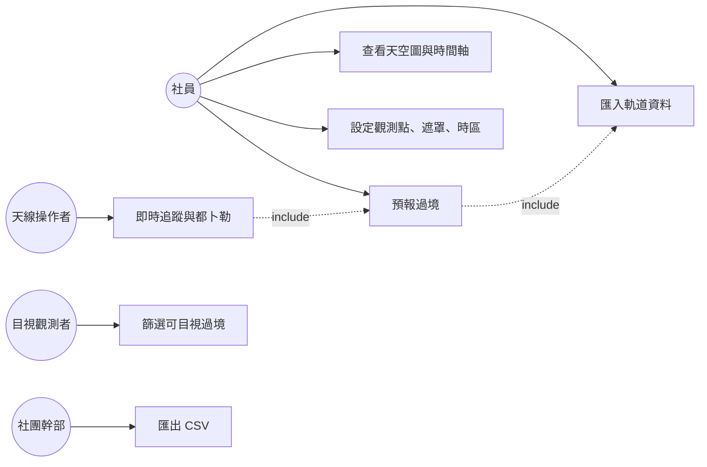

# 第 1 章　需求分析：從客戶故事到驗收標準

> **本章目標**
> 1. 從一段客戶描述中找出利害關係人、使用情境與真正的問題
> 2. 區分功能需求、非功能需求、限制條件與假設
> 3. 判斷一條需求是否「可測試」，並把不可測試的需求改寫成可測試的
> 4. 學會在開工前提出**會改變做法**的問題，而不是什麼都問

---

## 1.1 起點：客戶說了什麼

案名「過境預報台（SkyPass）」的客戶背景只有三句話：

> 一個業餘無線電社團，想在社團屋頂架設接收天線，收聽氣象衛星與國際太空站。
> 目前靠網站查過境時間，但網站**不能設定自己的遮罩仰角**，也**不會告訴她們都卜勒頻移**，**離線時完全不能用**。
> 她們想要一個桌面工具：匯入衛星軌道資料（TLE）後，離線預報過境、顯示天空圖與即時追蹤。

這三句話已經包含了需求分析最重要的東西：**現況的痛點**。好的需求分析從痛點出發，而不是從功能清單出發。

| 痛點 | 背後的真正需要 | 對應的功能 |
|---|---|---|
| 網站不能設定遮罩仰角 | 屋頂四周有建築物遮擋，低仰角的過境收不到，列出來只是雜訊 | 可設定遮罩、過境以遮罩為準 |
| 網站不會告訴都卜勒頻移 | 衛星以每秒 7 公里移動，接收頻率會偏移數 kHz，不修正就收不到 | 都卜勒曲線、即時頻率 |
| 離線時不能用 | 社團活動地點可能沒有網路；資料應由社員自己掌握 | 匯入 TLE、全部本機計算、不呼叫網路 |

> **教學重點**：如果只看功能清單（「要有天空圖」「要有時間軸」），很容易做出功能齊全但沒解決問題的軟體。
> 先問「現在的做法哪裡不夠」，功能的優先順序與驗收方式就會自然浮現。

## 1.2 利害關係人與使用情境

| 角色 | 目標 | 典型情境 |
|---|---|---|
| **社員（一般使用者）** | 知道接下來什麼時候能收到哪顆衛星 | 週末前打開程式，看未來兩天的過境表，挑仰角高的過境 |
| **天線操作者** | 過境時把天線對準、把接收機調到正確頻率 | 過境中看即時追蹤：方位角、仰角、倒數、接收頻率 |
| **目視觀測者** | 用肉眼看國際太空站 | 只看「可目視」的過境（衛星被太陽照亮、天色夠暗） |
| **社團幹部** | 把排程分享給其他社員 | 匯出 CSV 貼到社團群組 |
| **維護者**（隱性） | 半年後還能改得動 | 程式要分層清楚、有測試 |

畫成使用案例圖：

> **練習 1-1**：「維護者」沒有出現在客戶描述裡。為什麼仍要把他列為利害關係人？他的需求會反映在哪些非功能需求上？

## 1.3 需求分類

一份完整的需求文件通常包含四類東西，它們的處理方式不同：

| 類別 | 定義 | 本案例 |
|---|---|---|
| **功能需求** | 系統「做什麼」 | 匯入 TLE、預報過境、天空圖、時間軸、即時追蹤、匯出 CSV |
| **非功能需求（品質屬性）** | 系統「做得多好」 | 正確性（誤差上限）、效能（2 秒內）、反應性（畫面不卡）、可靠性（取消不留半套結果） |
| **限制條件** | 不能自己選的事 | C#／.NET 9、Silk.NET + ImGui、不得使用現成 SGP4 套件、所有「現在時間」透過 `TimeProvider` |
| **假設** | 為了讓問題有解而約定的簡化 | UT1 ≈ UTC、不考慮大氣折射、圓柱陰影模型、低精度太陽公式 |

### 功能需求（摘要）

1. **軌道資料管理**：匯入兩行或三行 TLE（CRLF/LF、UTF-8 含或不含 BOM），逐組驗證；錯誤組別指出行號與原因，其餘照常匯入；同一衛星保留較新者、最多 5 組歷史；深空軌道標示不支援；資料陳舊（相差 14 天以上）警告
2. **SGP4 傳播**：自行實作；失敗時回傳錯誤碼，不得擲例外
3. **時間與座標**：UTC↔儒略日、GMST、TEME→地固、大地→地固、站心方位角／仰角／距離／距離變化率
4. **過境預報**：AOS、最大仰角、LOS、起訖方位、持續時間；邊界標示；平行處理、可取消、有進度；**不得漏掉最大仰角 ≥ 遮罩 + 0.05° 的過境**
5. **都卜勒與即時追蹤**：頻率曲線、指定時刻頻移；每秒更新的即時追蹤
6. **日照與可見性**：陰影判定與進出時刻、太陽仰角、可目視時段
7. **畫面**：過境表（排序、篩選、聯動）、天空圖、24 小時時間軸、即時追蹤、軌道資料、設定、診斷
8. **輸出**：CSV（UTF-8 with BOM），可選時區

### 非功能需求的「量化」

注意這份需求最有價值的地方：**幾乎每一條品質要求都有數字**。

| 品質屬性 | 模糊的說法 | 本案的量化說法 |
|---|---|---|
| 正確性 | 「軌道要算準」 | SGP4 與參考實作相比，位置誤差 ≤ 1e-6 km、速度 ≤ 1e-9 km/s |
| 完整性 | 「不要漏掉過境」 | 不得漏掉任何最大仰角 ≥ 遮罩 + 0.05° 的過境 |
| 效能 | 「要快」 | 100 顆 × 7 天 × 遮罩 10° 在 8 核心上 ≤ 2 秒 |
| 反應性 | 「畫面不要卡」 | 即時追蹤單次更新 ≤ 1 毫秒；計算在背景執行 |
| 資源 | 「不要浪費記憶體」 | SGP4 熱路徑零配置（以配置計數斷言） |
| 可靠性 | 「取消要乾淨」 | 取消後不得產出半套結果；結果與執行緒數無關（逐位元相同） |

> **教學重點**：「要快」「要準」不是需求，是願望。無法量化的品質要求就無法驗收，最後只能靠爭論。

## 1.4 需求的可測試性

本案的需求附了 24 條**驗收標準**，每一條都寫明「判定方式」（單元測試、性質測試、效能測試、檢視文件）。
這是把需求轉成可驗證規格的典範。我們可以用一個簡單的檢查表判斷需求是否可測試：

| 檢查 | 不可測試的寫法 | 可測試的寫法 |
|---|---|---|
| 有沒有明確的輸入？ | 「處理各種 TLE」 | 「兩行或三行、CRLF 或 LF、UTF-8 含或不含 BOM」 |
| 有沒有明確的預期輸出？ | 「錯誤要處理好」 | 「錯誤組別要指出行號與原因，其餘照常匯入」 |
| 有沒有容差？ | 「AOS 要準」 | 「AOS 與 LOS 誤差 ≤ 0.1 秒」 |
| 邊界有沒有定義？ | 「過境」 | 「仰角由低於遮罩變為**不低於**遮罩」（≥ 而不是 >） |
| 比較對象是誰？ | 「要正確」 | 「與暴力參考解逐案一致」「與 Vallado 參考實作一致」 |

### 案例：「過境」這個詞的定義

日常語言的「過境」很模糊。需求的「假設事項」把它定義到可以寫成程式：

> 仰角由低於遮罩變為不低於遮罩（AOS）、達到最大值、再降到低於遮罩（LOS）的連續區段；最大仰角須 ≥ 遮罩。
> 起點時已在遮罩上方者，AOS 欄位填時間範圍起點並標示「起點前已開始」；終點同理。
> 最大仰角與遮罩相差小於 0.05° 的邊界過境，是否納入由實作決定，測試必須容忍。

最後一句特別值得注意：**需求主動承認了數值計算的不確定性**，並劃出一條「灰色地帶」。
這讓「不漏過境」可以被嚴格測試（≥ 遮罩 + 0.05° 的必須找到），又不會因為浮點誤差讓測試不穩定。

> **練習 1-2**：找出需求中另外兩個「主動定義灰色地帶」的地方（提示：可目視的「至少 1 秒」、陳舊的「超過 14 天」）。
> 如果需求沒有這樣定義，測試會遇到什麼困難？

## 1.5 釐清疑問：只問會改變做法的問題

開工前，我們讀完需求後只提出四個問題（見[設計文件 §9](../DESIGN.md)）。挑選標準是：**答案不同，做法就不同**。

| # | 問題 | 為什麼要問 | 決定 |
|---|---|---|---|
| Q1 | 驗收 #3 要求「至少 20 組已發表的近地驗證案例」，但 Vallado 發表的 `SGP4-VER.TLE` 只有 9 組近地案例，怎麼辦？ | 需求本身做不到，必須和客戶協商 | 以真實 TLE 補足，期望值由參考實作產生 |
| Q2 | 可以在工具鏈引入 Python 與 `sgp4` 套件來產生參考資料嗎？ | 會增加工具依賴（規範要求「引入新工具前要告知」） | 可以，只用於離線產生，正式程式與 CI 不需要 |
| Q3 | 介面用中文還是英文？字型要打包嗎？ | ImGui 預設字型沒有中文；打包字型會增加 10 MB 以上 | 中文介面，執行時載入系統字型，缺字型時退回英文 |
| Q4 | GitHub repo 是哪一個？誰推送？ | 推送是對外的動作，需要授權 | 先在本機完成，推送前再確認 |

同樣重要的是**沒有問**的問題。下列事項都有「合理預設」，就直接決定並在文件中記錄：

- 測試專案要一個還是多個？（題目寫「Tests 專案」→ 一個）
- 性質測試要用 FsCheck 還是自己寫？（規範「不得任意引入新套件」→ 自己寫一個 30 行的小工具）
- 「至少 1 秒可目視」是指單段還是總和？（取總和，記錄在文件）

> **教學重點**：問太多問題會讓客戶覺得你沒有判斷力；問太少則會做錯。
> 判斷標準只有一個：**這個問題的答案會不會改變我接下來要做的事？** 會，就問；不會，就選一個合理的預設並寫下來。

## 1.6 需求追溯：從需求到測試

需求分析的產出不是一份放著不動的文件，而是一張**追溯表**：每一條需求都要能追到設計、程式與測試。
本專案的 README 最後一節「驗收標準對照」就是這張表的精簡版，例如：

| 驗收 | 需求 | 設計 | 程式 | 測試 |
|---|---|---|---|---|
| #9 | 過境與暴力參考解一致 | 第 4 章：格點取樣 + 導數偵測 | `PassFinder` | `PassFinderPropertyTests.Property_matches_brute_force_reference` |
| #16 | 結果與執行緒數無關、取消不留半套 | 第 3 章：以衛星為平行單位、完成才發佈 | `PassPredictor`、`PredictionPresenter` | `PassPredictorTests`、`PredictionPresenterTests` |
| #18 | 資料庫損毀時不崩潰 | 第 3 章：儲存介面回報狀態 | `SqliteTleCatalogStore` | `StorageTests.Corrupt_database_file_is_reported_without_crashing` |

開發結束時，我們逐條對照這張表做了一次完整檢查，結果發現了幾個需求被漏做的地方（例如「過境表可依**時間**篩選」），
詳見[第 7 章](07-process-and-lessons.md)。這正是追溯表的價值：**它讓「漏做」變得看得見**。

## 1.7 本章小結

- 從**痛點**出發理解需求，功能只是解法
- 把品質要求**量化**，沒有數字的品質要求無法驗收
- 好的需求會**主動定義灰色地帶**（容差、邊界情況）
- 開工前只問**會改變做法**的問題，其他的選合理預設並記錄
- 用**追溯表**把需求連到設計、程式與測試，讓漏做變得看得見

## 練習

1. **（1-3）需求改寫**：把下列需求改寫成可測試的形式：「即時追蹤要夠即時」「CSV 要能用 Excel 開」「匯入大檔案時不能太慢」。
2. **（1-4）找出衝突**：「預報要快」與「不得漏掉任何過境」之間有什麼張力？本專案用什麼方式同時滿足？（讀完第 4 章再回答）
3. **（1-5）缺漏需求**：客戶沒有提到「日光節約時間」。對台灣的社團這不是問題，但對歐美使用者呢？你會怎麼處理這條「缺漏的需求」？
4. **（1-6）利害關係人訪談**：設計五個訪談問題給「天線操作者」，目標是確認即時追蹤頁需要顯示哪些資訊、以什麼精度顯示。
