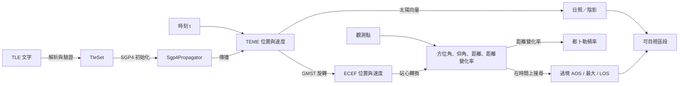
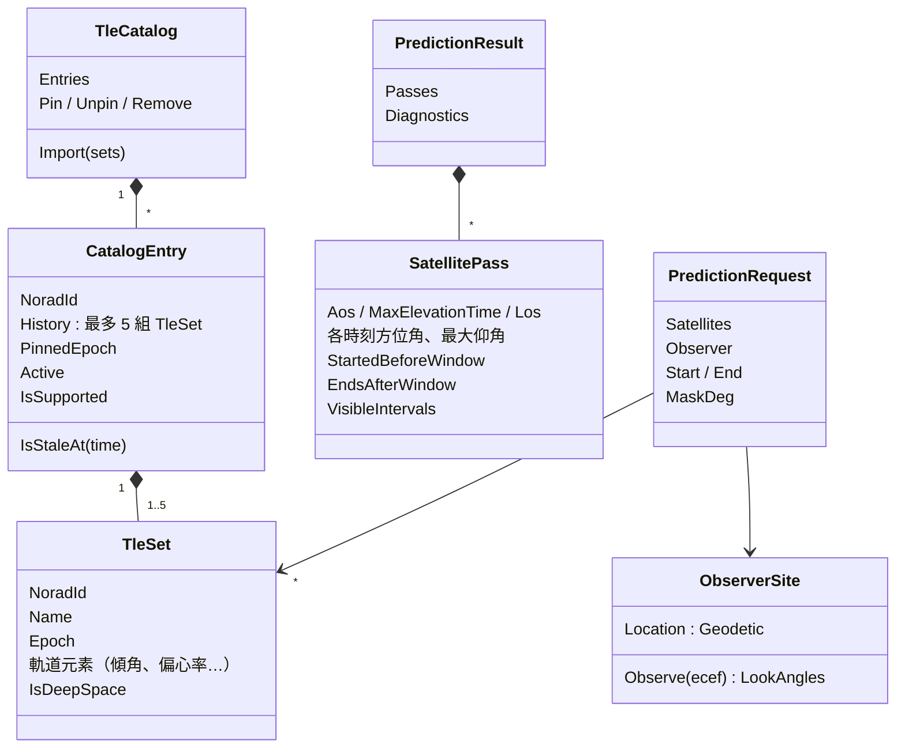
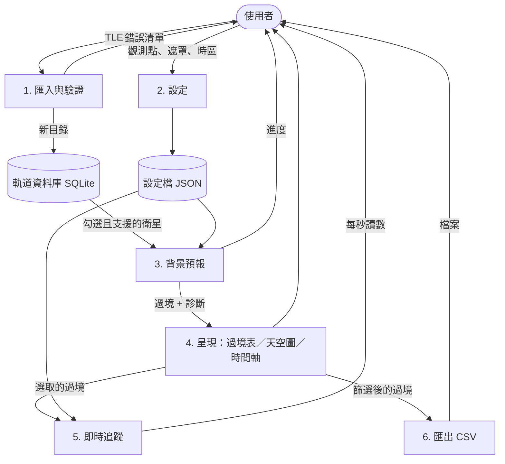
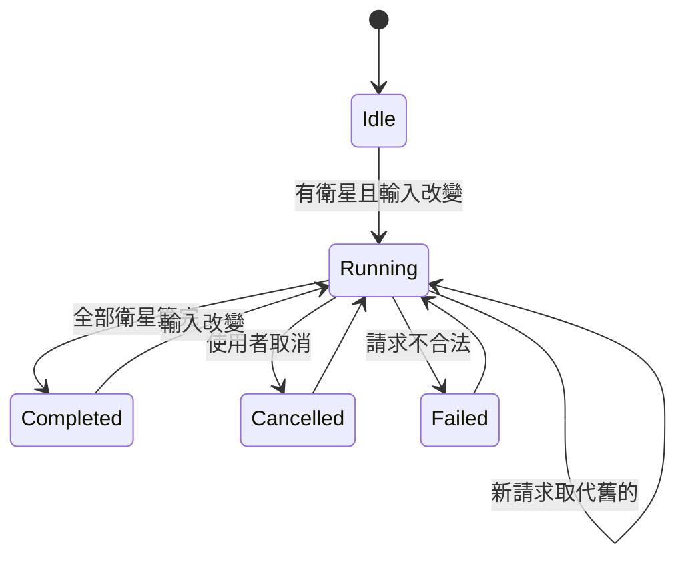

# 第 2 章　系統分析：把問題變成模型

> **本章目標**
> 1. 建立領域詞彙表，讓「客戶的話」與「程式的名字」一致
> 2. 畫出領域模型、資料流與狀態，找出系統的核心物件與它們的關係
> 3. 寫出**不變量**（invariant）：任何時候都必須成立的性質，它們會直接變成測試
> 4. 做風險分析：找出最可能出錯、出錯代價最高的地方，決定要在哪裡投入驗證

---

## 2.1 領域詞彙：先把話講清楚

系統分析的第一步是建立**共同語言**。下表的每個詞都會出現在程式的型別或成員名稱裡。

| 詞彙 | 意義 | 程式中的名字 |
|---|---|---|
| **TLE**（Two-Line Element set） | 描述衛星軌道的標準文字格式，兩行（或加名稱共三行）各 69 字元 | `TleSet`、`TleParser` |
| **epoch** | TLE 描述的那個時刻；離 epoch 越遠，預測越不準 | `TleSet.Epoch` |
| **NORAD 編號** | 衛星的唯一編號（超過 99999 後改用 Alpha-5，例如 `E8493`） | `TleSet.NoradId` |
| **SGP4** | 由 TLE 推算任意時刻衛星位置的標準模型 | `Sgp4Propagator` |
| **tsince** | 距 epoch 的分鐘數，SGP4 的時間輸入 | `Propagate(double tsinceMinutes, …)` |
| **TEME** | SGP4 輸出所用的慣性座標系（不隨地球自轉） | `TemeState` |
| **ECEF（地固座標）** | 隨地球自轉的座標系；觀測點在其中靜止 | `EcefState` |
| **GMST** | 格林威治平恆星時：地球相對慣性空間轉了多少角度，用來在 TEME 與 ECEF 之間轉換 | `Gmst` |
| **大地座標** | 緯度、經度、高度（WGS-84 橢球） | `Geodetic` |
| **站心座標** | 以觀測點為中心的方位角、仰角、距離 | `LookAngles` |
| **遮罩（mask）** | 低於這個仰角就收不到（被建築物擋住） | `MaskDeg` |
| **AOS／LOS** | Acquisition／Loss of Signal：仰角升到遮罩、降到遮罩以下的時刻 | `SatellitePass.Aos`／`Los` |
| **過境（pass）** | AOS 到 LOS 之間的連續區段 | `SatellitePass` |
| **距離變化率** | 衛星與觀測點距離的變化速度；接近時為負 | `RangeRateKmPerSec` |
| **都卜勒頻移** | 因距離變化率造成的接收頻率偏移 | `DopplerCalculator` |
| **地影** | 地球擋住陽光的區域；本案以圓柱近似 | `Shadow` |
| **可目視** | 衛星被太陽照到、且觀測點的天色夠暗（太陽仰角 < −6°） | `VisibilityCalculator` |

> **教學重點**：程式的名字就是領域詞彙。如果客戶說「過境」，程式裡卻叫 `Event` 或 `Window`，
> 每次溝通都要翻譯一次，久了就會出錯。這是領域驅動設計（DDD）「通用語言」的核心想法。

### 單位也是詞彙的一部分

數值程式最常見的錯誤之一是單位混用（度與弧度、公尺與公里、分鐘與秒）。本專案的規則：

- 公開 API 的角度一律以**度**表示，名稱以 `Deg` 結尾（`ElevationDeg`）
- 內部計算可用弧度，名稱以 `Rad` 結尾（`gmstRad`），且只能是 `internal`
- 距離以 km、速度以 km/s，名稱標示單位（`RangeKm`、`RangeRateKmPerSec`）
- 介面上的高度以公尺輸入，進入系統時立刻換成 km

這條規則甚至有**自動化測試**守著（以反射檢查 Core 的公開成員名稱不得含 `Rad`），見第 6 章。

## 2.2 核心問題的分解

「預報過境」看似一個功能，拆開來是一條計算管線：

這張圖告訴我們兩件重要的事：

1. **「某時刻的觀測量」是一個純函數**：給定 TLE、觀測點與時刻，結果唯一確定，沒有副作用。這是整個系統可以被精確測試、可以安全平行化的基礎。
2. **「過境」是在時間軸上的搜尋問題**：我們不能算每一個瞬間，只能取樣。取樣就可能漏掉——這是本案最大的技術風險（見 2.6）。

## 2.3 領域模型

幾個建模上的決定值得討論：

| 決定 | 理由 |
|---|---|
| `TleCatalog` 是**不可變值**：`Import` 回傳新的目錄，不修改舊的 | 背景匯入完成後可以整個替換，UI 讀到的永遠是一致的快照；測試時不必擔心共享狀態 |
| 「目前使用哪一組」由 `PinnedEpoch` 推導，不另存一個欄位 | 避免兩個欄位不一致（例如釘選的那組被擠出歷史，卻還指向它） |
| `SatellitePass` 帶「起點前已開始」「終點後才結束」旗標 | 時間範圍會切斷過境，切斷的過境不能和完整的過境混為一談 |
| 預報結果是一個獨立的 `PredictionResult` 物件，而不是散落的狀態 | 可以「整份」發佈或「整份」丟棄——這是「取消不留半套結果」的基礎 |

> **練習 2-1**：如果 `CatalogEntry` 多存一個 `ActiveIndex` 欄位，而不是由 `PinnedEpoch` 推導，
> 在什麼操作順序下會出現不一致？寫出一個具體的操作序列。

## 2.4 資料流

從使用者的角度，資料在系統中的流動如下（DFD 第 1 層）：

注意兩個資料儲存都是**本機檔案**，沒有任何外部服務——這直接對應「離線可用」的需求。

## 2.5 狀態

### 預報的狀態

關鍵的設計約束寫在轉移上：**只有 `Completed` 會替換「目前的結果」**。
`Cancelled` 與 `Failed` 只改變狀態與訊息，結果仍是上一次完整的那一份。這就是「取消後不得產出半套結果」的狀態機表達。

### 軌道資料的狀態

每顆衛星在畫面上顯示三種狀態之一，優先順序由高到低：

| 狀態 | 條件 | 是否預測 |
|---|---|---|
| 不支援 | 週期 ≥ 225 分鐘（深空軌道） | 否 |
| 陳舊 | 預測時間與 epoch 相差超過 14 天 | 是，但產生警告 |
| 可預測 | 其他 | 是 |

## 2.6 不變量：一定要成立的事

**不變量**是系統在任何情況下都必須成立的性質。寫出不變量有兩個好處：設計時它是約束，測試時它直接變成斷言。

| 對象 | 不變量 | 後來變成的測試 |
|---|---|---|
| 過境 | AOS ≤ 最大仰角時刻 ≤ LOS；未被切斷的端點，仰角等於遮罩 | `Property_pass_invariants` |
| 過境 | 同一顆衛星的過境互不重疊，且依時間排序 | 同上 |
| 過境 | 方位角 ∈ [0°, 360°) | 同上 |
| 過境集合 | 遮罩提高時，過境集合只會縮小（每個高遮罩的過境都包含在某個低遮罩的過境裡） | `Property_raising_mask_shrinks_pass_set` |
| 過境集合 | 把 [t0, t2] 拆成 [t0, t1] 與 [t1, t2]，合併後與一次預測相同 | `Property_window_split_invariance` |
| 預報 | 結果與執行緒數無關 | `Property_result_is_independent_of_thread_count` |
| 目錄 | 每顆衛星的歷史依 epoch 由新到舊、最多 5 組 | `Property_active_is_newest_and_history_sorted_and_capped` |
| 時間 | 較晚的 UTC 時刻，儒略日一定較大 | `Property_utc_roundtrip_and_monotonic` |
| TLE | 解析 → 格式化 → 解析，欄位不變 | `Property_parse_format_parse_preserves_fields` |

> **教學重點**：注意「視窗拆分不變性」這條。它不是需求直接寫出來的「功能」，
> 而是從「預測結果應該只取決於物理事實，不取決於你怎麼切時間範圍」推導出來的。
> 能寫出這種不變量，代表你真正理解了問題；而它在第 4 章直接決定了演算法的設計（全域對齊的取樣格點）。

## 2.7 風險分析

不是每個地方都值得同樣多的驗證。下表以「出錯機率 × 出錯代價」排序，決定測試資源要投在哪裡。

| 風險 | 機率 | 代價 | 對策 |
|---|---|---|---|
| **漏掉掠過過境**（最大仰角只比遮罩高一點點） | 高：固定步長取樣天生會漏 | 高：需求明文禁止 | 演算法用導數偵測極值（第 4 章）；60 組刻意構造的案例；與逐秒暴力解比對 320 組 |
| **SGP4 移植錯一個運算式** | 中：約 500 行密集的數學 | 高：所有結果都錯，而且錯得「看起來合理」 | 逐行移植；與參考實作比對 23 + 320 組，容差 1e-6 km |
| **數值精度不足**（儒略日、GMST） | 中：double 只有約 16 位有效數字 | 中：GMST 誤差直接變成方位角誤差 | 兩段式儒略日；以 60 位十進位參考值驗證 |
| **多執行緒造成結果不一致或半套結果** | 中 | 高：難以重現的 bug | 純函數核心 + 以衛星為平行單位 + 完成才發佈；1 對 N 執行緒逐位元比對 |
| **時間處理錯誤**（時區、跨日、閏年） | 中 | 中 | Core 一律 UTC；只在顯示時換時區；跨日、跨月、2100 年非閏年的測試 |
| **衛星衰減時程式崩潰** | 低 | 高 | 傳播回傳錯誤碼不擲例外；預報停止並產生診斷 |
| **資料庫或設定檔損毀** | 低 | 中 | 載入時回報狀態、退回預設值，不崩潰 |

> **練習 2-2**：上表把「漏掉掠過過境」的機率評為「高」。請用一個具體例子說明：
> 每 30 秒取樣一次仰角、只看「有沒有超過遮罩」，在什麼情況下一定會漏掉過境？
> （提示：一個最大仰角只比遮罩高 0.1° 的過境，在遮罩之上停留多久？）

## 2.8 本章小結

- 建立**領域詞彙表**，讓程式的名字等於客戶的話；**單位**也是詞彙的一部分
- 把功能拆成**計算管線**，找出其中的純函數部分——它是可測試性與可平行化的基礎
- 用領域模型、資料流與狀態圖描述系統；把「取消不留半套結果」這類需求表達成**狀態轉移的約束**
- 寫出**不變量**：它們既是設計約束，也會直接變成測試
- 用**風險分析**決定驗證資源要投在哪裡

## 練習

1. **（2-3）詞彙對照**：從 `src/SkyPass.Core` 挑 10 個公開型別或成員，找出它們在本章詞彙表中的對應。有沒有哪個名字你覺得不夠清楚？你會怎麼改？
2. **（2-4）新增不變量**：為「可目視區段」寫出至少兩條不變量（提示：它和過境、陰影的關係）。
3. **（2-5）狀態機擴充**：如果要加入「暫停預報」功能，預報的狀態圖要怎麼改？「暫停後恢復」的結果必須和「沒暫停」完全相同嗎？為什麼？
4. **（2-6）風險再評估**：假設客戶要求加入「深空軌道（GEO）支援」。風險分析表的哪幾列會改變？新增哪些風險？
