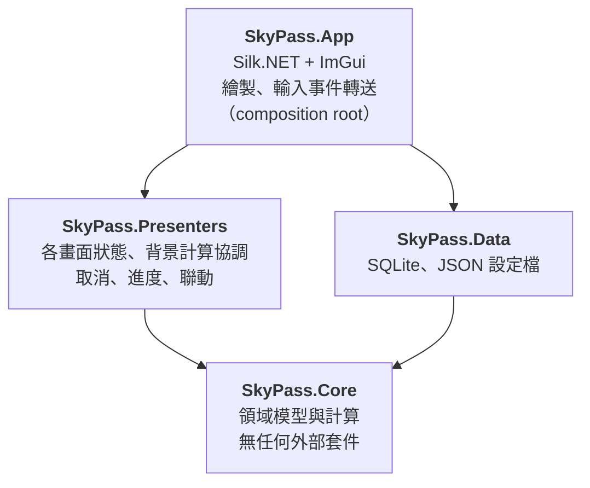

# 第 3 章　架構設計：決定程式的骨架

> **本章目標**
> 1. 理解分層架構與**依賴方向**，以及為什麼「介面定義在內層」
> 2. 學會「純函式核心、命令式外殼」：把可測試的部分和難測的部分分開
> 3. 設計一個不需要鎖、不需要 UI 執行緒同步的**快照式執行緒模型**
> 4. 用**架構決策紀錄**記下取捨，並用**自動化測試**守住架構

---

## 3.1 從限制條件出發

架構不是憑空設計的，它由需求與限制條件推出來。本案有幾條限制直接決定了骨架：

| 限制條件（需求原文） | 架構上的後果 |
|---|---|
| Core：純 net9.0，不引用任何 UI、OpenGL 或 Windows 專用組件 | 所有計算必須和畫面完全分開 |
| Presenters：純 net9.0，不引用 UI。放各畫面的狀態、背景計算的協調、取消與進度 | 「畫面的邏輯」也要能在沒有視窗的情況下測試 |
| App：只保留繪製與事件轉送 | App 不能有任何判斷邏輯 |
| 所有版面、座標、刻度計算放在不引用 UI 的函式庫 | 連「天空圖上的點在哪個像素」都要在 Core 算 |
| 所有「現在時間」透過 `TimeProvider` | 時間是一個可注入的依賴，測試可以控制時間 |
| 計算在背景執行，畫面不得卡住 | 需要一個執行緒模型 |

> **教學重點**：注意這些限制的共同目的——**讓所有邏輯都能在沒有視窗、沒有真實時鐘的情況下被測試**。
> 這是一份「為可測試性而寫」的需求，架構只是把它落實。

## 3.2 分層與依賴方向



**依賴規則**：箭頭只能指向內層。Core 不知道任何其他專案的存在；Presenters 不知道資料存在 SQLite 裡；只有 App 知道全部。

### 為什麼 Data 依賴 Core，而不是反過來？

直覺的分層常是「UI → 邏輯 → 資料存取」，邏輯層依賴資料層。本專案刻意**反轉**了這個方向：

```csharp
// src/SkyPass.Core/Storage/ITleCatalogStore.cs —— 介面定義在 Core（內層）
public interface ITleCatalogStore
{
    CatalogLoadResult Load();
    void Save(TleCatalog catalog);
}

// src/SkyPass.Data/SqliteTleCatalogStore.cs —— 實作放在 Data（外層）
public sealed class SqliteTleCatalogStore(string databasePath, TimeProvider? clock = null) : ITleCatalogStore
```

這就是**依賴反轉原則**（DIP）：高層模組（Presenters）依賴抽象（`ITleCatalogStore`），抽象由誰擁有？由**使用它的一方**（內層）擁有。

結果是：

- Presenters 的測試用一個 20 行的 `InMemoryCatalogStore` 取代 SQLite，測試不碰檔案系統、跑得快、不會互相干擾
- 要換成別的儲存方式（雲端、純文字），只需新增一個實作，Core 與 Presenters 一行都不用改

```csharp
// tests/SkyPass.Tests/Support/Fakes.cs
public sealed class InMemoryCatalogStore(StoreStatus status = StoreStatus.Ok, TleCatalog? initial = null) : ITleCatalogStore
{
    public TleCatalog Saved { get; private set; } = initial ?? TleCatalog.Empty;
    public CatalogLoadResult Load() => /* … */;
    public void Save(TleCatalog catalog) { /* 只存在記憶體 */ }
}
```

> **練習 3-1**：假設把 `ITleCatalogStore` 搬到 Data 專案裡。畫出新的依賴圖，並說明 Presenters 的測試會受到什麼影響。

## 3.3 純函式核心、命令式外殼

把系統裡的程式碼按「有沒有副作用」分類：

| 類型 | 例子 | 測試難度 |
|---|---|---|
| **純函數**：輸出只取決於輸入，沒有副作用 | SGP4 傳播、座標轉換、過境搜尋、CSV 格式化、天空圖投影 | 極容易：給輸入、比輸出 |
| **有狀態但確定**：狀態只因明確的方法呼叫而改變 | `PassTablePresenter` 的排序與選取 | 容易：呼叫方法、檢查狀態 |
| **有外部副作用**：時間、檔案、執行緒、GPU | 讀時鐘、存資料庫、背景執行緒、OpenGL 繪製 | 困難 |

架構的目標是**讓第一類盡量大、第三類盡量薄**。在本專案中：

- **Core** 幾乎全是純函數（唯一的「外部」是傳入的 `TimeProvider` 與 `CancellationToken`）
- **Presenters** 是有狀態但確定的；所有副作用（時間、儲存、背景執行）都透過注入的介面
- **App** 是唯一碰 OpenGL 與真實時鐘的地方，而且它只是「讀狀態、畫出來」

這種模式常被稱為 *Functional Core, Imperative Shell*。它的直接成果是：384 個測試中，只有 Data 層的 15 個會建立真實的資料庫與設定檔
（其餘讀檔的測試只是讀取唯讀的參考資料），**沒有任何一個需要開視窗**，Presenter 的測試也全部不碰磁碟與真實時鐘。

### 時間也是依賴

需求規定「所有現在時間透過 `TimeProvider`」。為什麼？看即時追蹤的測試：

```csharp
// tests/SkyPass.Tests/Presenters/LiveTrackingPresenterTests.cs（節錄）
var clock = new FakeTimeProvider(utc);            // 測試控制「現在」
var p = new LiveTrackingPresenter(clock);
// …
clock.Advance(TimeSpan.FromDays(-1));             // 時間回溯一天
p.Tick();
```

如果 Presenter 內部直接呼叫 `DateTime.UtcNow`，「時間回溯後狀態正確」這條驗收標準就根本無法測試。
開發後期我們用一個**原始碼掃描測試**確保 `src/` 下沒有任何地方直接讀系統時鐘（第 6 章），而這個測試真的抓到了兩處違規（第 7 章）。

## 3.4 執行緒模型：快照與每幀更新

需求要求「計算在背景執行，畫面不得卡住」，同時「取消後不得產出半套結果」。常見的做法是事件 + `SynchronizationContext`：背景執行緒完成後，把結果「推」回 UI 執行緒。本專案用了一個更簡單的模型。

### 觀察：ImGui 每一幀都會重畫整個畫面

ImGui 是 *immediate mode* GUI：沒有「控制項物件」，每一幀都從頭描述畫面。所以 UI 不需要被「通知」——它每一幀本來就會讀最新狀態。

### 模型：背景只「發佈快照」，UI 每幀「拉」

```
UI 執行緒（每幀約 16 ms）                       背景執行緒
────────────────────────────                   ─────────────────────────
MainPresenter.Update()
 ├ 比對版本號：輸入改變？ ─► PredictionPresenter.StartAsync ─► Task.Run(Predict)
 ├ 讀 Prediction.State（Volatile 讀）◄──────── 完成時 Volatile.Write 一份完整的新快照
 ├ 版本號改變 → 交給過境表、時間軸、診斷
 └ 選取改變 → 交給天空圖、即時追蹤
App 繪製（只讀快照）
```

背景執行緒只做一件事：**算完後，用一次原子寫入替換整個狀態物件**。

```csharp
// src/SkyPass.Presenters/PredictionPresenter.cs（節錄）
public sealed record PredictionState(
    PredictionStatus Status, PredictionResult? Result, PredictionRequest? Request,
    string? Message, int Version, TimeSpan? Elapsed);

public PredictionState State => Volatile.Read(ref _state);

/// 只有最新的一次執行可以改變狀態；被取代的舊執行結束時什麼都不做。
private void Finish(int runId, Func<PredictionState, PredictionState> update)
{
    lock (_gate)
    {
        if (runId != _runId)
        {
            return;
        }
        // …以 Volatile.Write 發佈新的不可變快照
    }
}
```

這個設計同時解決了三個問題：

| 問題 | 解法 |
|---|---|
| UI 讀到「改到一半」的狀態 | 狀態是不可變的 `record`，整份替換；讀者要嘛看到舊的、要嘛看到新的 |
| 取消後出現半套結果 | 只有「完成」才寫入新的 `Result`；取消只改 `Status` |
| 使用者連點兩次「預報」，舊的比新的晚完成，覆蓋了新結果 | 每次執行有 `runId`，只有最新的那一次能寫入 |

### 聯動：版本號比對，而不是事件

各畫面之間的聯動（選取過境 → 天空圖、時間軸、即時追蹤跟著變）也不用事件，而是在 `MainPresenter.Update()` 中比對版本號：

```csharp
// src/SkyPass.Presenters/MainPresenter.cs（節錄）
public void Update()
{
    // 1. 預報輸入改變（目錄、觀測點、遮罩、天數）→ 重新預報
    var key = (Catalog.Version, site, settings.MaskDeg, settings.PredictionDays);
    if (_requestKey != key) RequestPrediction();

    // 2. 新的預報結果或顯示時區改變 → 更新過境表、時間軸、診斷
    var shown = (state.Version, state.Status, settings.DisplayUtcOffset, Settings.Version);
    if (_shown != shown) { _shown = shown; ShowPrediction(state, settings); }

    // 3. 選取改變 → 天空圖、時間軸、即時追蹤聯動
    if (PassTable.SelectionVersion != _selectionSeen) { /* … */ }
    // …
}
```

**為什麼不用事件？**

| 事件（push） | 版本號比對（pull） |
|---|---|
| 背景執行緒觸發事件 → 處理器在背景執行緒執行 → 要 marshal 回 UI | 所有傳遞都在呼叫 `Update()` 的那個執行緒 |
| 事件順序、重入、忘記取消訂閱都是常見 bug | 沒有訂閱，沒有順序問題 |
| 測試要等事件、處理非同步 | 測試直接呼叫 `Update()`，同步、確定 |

代價是每幀都要比對幾個整數——成本可以忽略。

> **教學重點**：架構選擇應該配合框架的特性。在 WPF 這類 *retained mode* 框架中，事件與資料繫結是自然的選擇；
> 在 ImGui 這類 *immediate mode* 框架中，「每幀拉取快照」更簡單、更不容易錯。**沒有放諸四海皆準的架構**。

> **練習 3-2**：`MainPresenter.Update()` 用 tuple 作為「預報輸入」的鍵。如果漏了 `settings.PredictionDays`，會發生什麼 bug？使用者要做什麼操作才會觸發它？

## 3.5 平行化的設計

需求要求「多顆衛星平行處理」且「結果與執行緒數無關（1 與 N 個執行緒逐位元相同）」。

```csharp
// src/SkyPass.Core/Passes/PassPredictor.cs（節錄）
Parallel.For(0, count, options, i =>
{
    perSatellite[i] = PredictOne(request, site, request.Satellites[i], cancellationToken);
    reporter.Increment();
});

cancellationToken.ThrowIfCancellationRequested();
var passes = perSatellite.SelectMany(r => r.Passes)
    .OrderBy(p => p.Aos.Day).ThenBy(p => p.Aos.Fraction).ThenBy(p => p.NoradId)
    .ToList();
```

三個關鍵選擇：

1. **平行單位是「衛星」**：每顆衛星的計算是完全獨立的循序程序，同樣的輸入一定得到同樣的浮點結果
2. **結果寫入以索引定位的陣列**：不用 `ConcurrentBag`（順序不確定），也不用鎖
3. **最後做一次穩定排序**：排序鍵是（AOS, NORAD），與哪個執行緒先完成無關

這讓「逐位元相同」成為**結構上的保證**，而不只是測試碰巧通過。

另外，`SGP4` 傳播器本身必須是執行緒安全的。原始的 Vallado C 程式碼會在傳播時寫回物件的欄位；移植時把這些欄位全部改成區域變數，傳播器在初始化後就**不可變**，自然執行緒安全（第 4 章）。

## 3.6 架構決策紀錄（ADR）

重要的取捨應該寫下來：當時考慮了什麼、選了什麼、付出什麼代價。以下是本專案的幾個例子（完整版見 [README 設計取捨](../../README.md#設計取捨)）：

| 決策 | 考慮過的替代方案 | 選擇的理由 | 代價 |
|---|---|---|---|
| 介面放 Core，實作放 Data | 介面放 Data | Presenters 不必引用儲存技術；測試用記憶體替身 | 多一層間接 |
| 快照 + 每幀 `Update()` | 事件 + `SynchronizationContext` | 配合 ImGui；測試同步、確定 | 每幀比對版本號 |
| 以衛星為平行單位，完成才發佈 | 以時間片段為單位平行 | 結果與執行緒數無關；取消不留半套 | 單顆衛星很長的預報無法細分平行 |
| SQLite 保存 TLE 原文 | 保存解析後的欄位 | 往返無損；格式化規則改了也不影響舊資料 | 每次載入要重新解析（很快） |
| 自寫性質測試工具 | 引入 FsCheck | 規範禁止任意引入套件；需求很簡單 | 沒有自動縮小反例 |

> **教學重點**：ADR 的價值不在於「選對」，而在於讓六個月後的人（包括你自己）知道**為什麼**這樣做，
> 以及**在什麼條件改變時應該重新考慮**。例如「單顆衛星很長的預報無法細分平行」——如果哪天要預報一顆衛星一整年，這個決策就該重新評估。

## 3.7 用測試守住架構

架構規則如果只寫在文件裡，很快就會被破壞。本專案把三條規則寫成了自動化測試：

```csharp
// tests/SkyPass.Tests/Architecture/LayeringTests.cs（節錄）
[Theory]
[InlineData("SkyPass.Core")]
[InlineData("SkyPass.Presenters")]
public void Pure_libraries_do_not_reference_ui_or_storage_assemblies(string assemblyName)
{
    var references = Assembly.Load(assemblyName).GetReferencedAssemblies().Select(a => a.Name!).ToList();
    var offending = references.Where(r => ForbiddenPrefixes.Any(p => r.StartsWith(p, StringComparison.Ordinal)));
    Assert.Empty(offending);
}
```

| 規則 | 測試 |
|---|---|
| Core 與 Presenters 不引用 UI、OpenGL、SQLite | `Pure_libraries_do_not_reference_ui_or_storage_assemblies` |
| `src/` 不得直接讀系統時鐘 | `Source_never_reads_the_system_clock_directly`（掃描原始碼） |
| Core 的公開 API 不得出現弧度 | `Public_core_api_exposes_no_radian_parameters_or_members`（反射） |

這類測試被稱為**架構適應度函數**（architecture fitness function）。開發過程中第一條規則還真的擋下了一次違規：
`CatalogPresenter` 為了捕捉資料庫錯誤，寫了 `catch (Microsoft.Data.Sqlite.SqliteException)`——這讓 Presenters 依賴了 SQLite。
改成捕捉 .NET 內建的 `System.Data.Common.DbException` 後就符合規則了。

## 3.8 專案結構總覽

```
SkyPass.sln
├─ src/
│  ├─ SkyPass.Core/            領域模型與計算（無外部套件）
│  │  ├─ Tle/                  解析、格式化、目錄規則
│  │  ├─ Propagation/          SGP4
│  │  ├─ Time/                 儒略日、GMST、時間顯示
│  │  ├─ Coordinates/          座標轉換、觀測點、觀測量
│  │  ├─ Sun/                  太陽位置、陰影
│  │  ├─ Passes/               過境搜尋、多衛星預報
│  │  ├─ Visibility/  Doppler/ 可目視、都卜勒
│  │  ├─ Layout/               天空圖與時間軸幾何、DPI
│  │  ├─ Export/               CSV
│  │  └─ Storage/              儲存介面與設定模型（由 Data 實作）
│  ├─ SkyPass.Data/            SQLite、JSON 設定檔
│  ├─ SkyPass.Presenters/      9 個 Presenter
│  └─ SkyPass.App/             視窗、各頁繪製、截圖
├─ tests/SkyPass.Tests/        單元／性質／效能／架構測試、參考解、參考資料
├─ tools/refgen/               離線產生參考資料的 Python 腳本
├─ samples/                    範例 TLE 與預期過境表
└─ docs/                       設計文件、測試報告、手算範例、本教材
```

## 3.9 本章小結

- 架構由**限制條件**推導；本案的限制幾乎都在追求「沒有視窗也能測試」
- **依賴反轉**：介面由使用它的內層擁有，外層提供實作
- **純函式核心、命令式外殼**：讓純函數部分盡量大、副作用部分盡量薄；**時間也是依賴**
- **快照 + 每幀拉取**：背景只做原子替換，UI 每幀讀最新快照；聯動用版本號比對
- 平行化的「決定性」應該是**結構上的保證**：獨立單位、索引陣列、穩定排序
- 用 **ADR** 記錄取捨，用**架構測試**守住規則

## 練習

1. **（3-3）換框架**：如果把 App 改用 WPF（retained mode）實作，Presenters 需要改嗎？哪些部分可以原封不動？你會如何把「每幀拉取」換成資料繫結？
2. **（3-4）加入新儲存**：設計一個 `JsonTleCatalogStore`（把目錄存成 JSON 檔）。需要修改哪些專案？寫出你會為它加的測試清單。
3. **（3-5）找出副作用**：閱讀 `src/SkyPass.Presenters/LiveTrackingPresenter.cs`，列出它所有的副作用來源，說明每一個是如何被隔離或注入的。
4. **（3-6）挑戰快照模型**：快照模型有什麼缺點？在什麼情況下（資料量、更新頻率）它會變得不適合？
