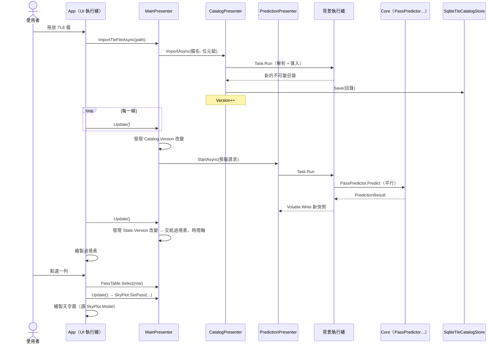

# 第 5 章　程式導讀：一筆資料的旅程

> **本章目標**
> 1. 跟著一筆資料，從「使用者拖放 TLE 檔」走到「天空圖上的一條線」，看各層如何分工
> 2. 看懂非同步、背景執行、快照發佈在實際程式碼中長什麼樣子
> 3. 學會一套**閱讀陌生程式碼**的方法：從進入點與資料流切入，而不是從檔案清單切入

---

## 5.1 如何閱讀一個陌生的程式碼庫

面對 50 個以上的原始檔，不要從第一個檔案讀到最後一個。建議的順序：

1. **讀 README 與架構圖**：知道有哪些層、依賴方向（第 3 章）
2. **找進入點**：桌面程式的 `Main`、每幀的 `Render`
3. **挑一個使用情境，跟著資料走**：本章選「匯入 TLE → 看到天空圖」
4. **遇到核心演算法時，先讀它的測試**：測試告訴你「它應該做什麼」，再讀實作「它怎麼做」
5. **最後才補齊**其他檔案

## 5.2 全景：一張循序圖



注意兩件事：

- **UI 執行緒從不等待**：所有慢的工作都交給 `Task.Run`，結果透過快照與版本號在下一幀被「拉」回來
- **沒有任何事件或回呼**把背景結果推回 UI——全部靠 `Update()` 比對版本號（第 3 章）

## 5.3 第一站：App 收到檔案

```csharp
// src/SkyPass.App/AppHost.cs
private void OnFileDrop(string[] paths)
{
    foreach (var path in paths)
    {
        _ = _main.ImportTleFileAsync(path);
    }

    _ui.Page = Page.Catalog;
}
```

App 只做兩件事：把路徑轉交給 Presenter、切換到「軌道資料」頁。`_ = …` 表示刻意不等待（fire-and-forget）：
UI 執行緒繼續繪製，匯入在背景進行。錯誤不會遺失，因為 Presenter 會把它們寫進診斷頁。

每一幀的流程也很單純：

```csharp
// src/SkyPass.App/AppHost.cs
private void OnRender(double delta)
{
    _main.Update();                 // ① 先讓 Presenter 同步一次狀態
    // …
    TickLiveTracking();             // ② 換秒時讓即時追蹤更新一次
    DrawRoot(now);                  // ③ 讀快照、畫畫面
    _imgui.Render();
}
```

> **觀察**：App 裡沒有任何 `if (衛星已衰減)`、`if (遮罩改變)` 這類判斷。所有「要不要做什麼」的決定都在 Presenter。這就是「App 只保留繪製與事件轉送」的實際樣貌。

## 5.4 第二站：背景匯入，產生新的目錄

```csharp
// src/SkyPass.Presenters/CatalogPresenter.cs
public async Task ImportAsync(string fileName, byte[] content)
{
    var (parsed, imported) = await Task.Run(() =>
    {
        var p = TleParser.Parse(content);
        TleCatalog current;
        lock (_gate)
        {
            current = _catalog;
        }

        return (p, current.Import(p.Sets));
    }).ConfigureAwait(false);

    LastImport = new ImportReport(fileName, parsed.Sets.Count, imported.Summary, parsed.Errors);
    // …把每個錯誤（含行號）寫進診斷頁
    Replace(imported.Catalog, save: true);
}
```

逐行解讀：

| 程式碼 | 意義 |
|---|---|
| `Task.Run(() => …)` | 解析可能有上千組 TLE，放到執行緒池，不阻塞 UI |
| `TleParser.Parse(content)` | 純函數：位元組進、`TleParseResult`（成功的組 + 錯誤清單）出。處理 BOM、CRLF、兩行／三行 |
| `current.Import(p.Sets)` | `TleCatalog` 是**不可變**的，`Import` 回傳**新的**目錄，舊的不受影響 |
| `.ConfigureAwait(false)` | 之後的程式不需要回到原本的執行緒（Presenter 沒有 UI 執行緒的概念） |
| `Replace(…, save: true)` | 原子地替換目錄、遞增 `Version`、寫入資料庫（資料庫不可寫時改為提示） |

`Version` 遞增後，這一站就結束了。沒有通知任何人——下一幀的 `MainPresenter.Update()` 會自己發現。

## 5.5 第三站：主協調器發現改變，啟動預報

```csharp
// src/SkyPass.Presenters/MainPresenter.cs（節錄）
var key = (Catalog.Version, site, settings.MaskDeg, settings.PredictionDays);
if (_requestKey != key)
{
    RequestPrediction();
}
```

`RequestPrediction()` 從目錄取出「勾選且支援預測」的衛星（深空軌道在這裡被排除）、從設定取出觀測點與遮罩，
組成一個 `PredictionRequest`，交給 `PredictionPresenter.StartAsync`。

`StartAsync` 會先**取消**還在跑的舊預報，再用 `runId` 標記這一次執行（見第 3 章 3.4 節）。
所以使用者連續改三次遮罩，只有最後一次的結果會被顯示。

## 5.6 第四站：平行預報

```csharp
// src/SkyPass.Core/Passes/PassPredictor.cs（節錄）
Parallel.For(0, count, options, i =>
{
    perSatellite[i] = PredictOne(request, site, request.Satellites[i], cancellationToken);
    reporter.Increment();
});
```

每顆衛星的 `PredictOne` 依序做：

1. **陳舊檢查**：預測時間與 epoch 相差超過 14 天 → 加一筆警告診斷（仍然預測）
2. `Sgp4Propagator.Create(tle)`：SGP4 初始化（只做一次）
3. `PassFinder.Find(...)`：第 4 章的過境搜尋
4. `VisibilityCalculator.ComputeIntervals(...)`：對每個過境算可目視區段

過境搜尋的最內層，是每個取樣點都會呼叫的這個函數：

```csharp
// src/SkyPass.Core/Coordinates/ObserverSite.cs
public static Sgp4Error Compute(Sgp4Propagator propagator, ObserverSite site, in JulianDate time, out Observation observation)
{
    var error = propagator.Propagate(time, out var teme);   // SGP4：TEME 位置與速度
    if (error != Sgp4Error.None)
    {
        observation = default;
        return error;                                        // 衰減：回傳錯誤碼，不擲例外
    }

    var ecef = Frames.TemeToEcef(teme, Gmst.ComputeRad(time));   // 旋轉到地固座標
    observation = new Observation(teme, ecef, site.Observe(ecef)); // 方位角、仰角、距離、變化率
    return Sgp4Error.None;
}
```

這是整個系統的**熱路徑**：100 顆 × 7 天約被呼叫兩百萬次。它的每一個型別（`JulianDate`、`TemeState`、`EcefState`、`Observation`）都是 `readonly struct`，
全部配置在堆疊上——400 萬次呼叫的記憶體配置量經測試為 **0 bytes**。

> **觀察**：`in` 參數與 `out` 參數讓大的 struct 以參考傳遞，避免複製；`readonly struct` 讓編譯器知道不會被修改。這些是 C# 寫高效能數值程式的基本工具。

## 5.7 第五站：完成，發佈快照

所有衛星算完後，`PredictionPresenter` 在背景執行緒做一次原子寫入：

```csharp
Finish(runId, s => s with
{
    Status = PredictionStatus.Completed,
    Result = result,
    Version = s.Version + 1,
    Elapsed = _clock.GetElapsedTime(started),
});
```

`s with { … }` 是 C# record 的**非破壞性修改**：產生一個新物件，只改指定的欄位。舊的快照完全不受影響，正在讀它的 UI 執行緒也不會看到「改到一半」的狀態。

如果使用者在這之前按了取消，`PassPredictor` 會擲出 `OperationCanceledException`，這段程式根本不會執行，`Result` 仍是上一次完整的結果。

## 5.8 第六站：顯示過境表，使用者點選

下一幀，`MainPresenter.Update()` 發現 `State.Version` 改變，把結果交給 `PassTablePresenter.SetPasses(...)`。

`PassTablePresenter` 負責排序、篩選、把時間依顯示時區格式化成字串，並保留選取（重新預報後，用「同一顆衛星且時間重疊」找回原本選取的過境）。
App 的過境表只是把 `Rows` 一列一列畫出來：

```csharp
// src/SkyPass.App/Views/PassesPage.cs（節錄）
if (ImGui.Selectable($"{r.Satellite}##{i}", r.IsSelected, ImGuiSelectableFlags.SpanAllColumns))
{
    main.PassTable.Select(r);
}
```

點選後，`SelectionVersion` 遞增。下一幀的 `Update()` 把選取的過境交給天空圖、時間軸與即時追蹤。

## 5.9 終點：天空圖

```csharp
// src/SkyPass.Presenters/SkyPlotPresenter.cs
private SkyPlotModel Build()
{
    var layout = SkyPlotLayout.Fit(_viewport.X, _viewport.Y, _viewport.W, _viewport.H, margin: 24);
    IReadOnlyList<TrackPoint> track = _pass is not null && _propagator is not null && _site is not null
        ? SkyTrack.Build(_propagator, _site, _pass, layout, MaxPixelGap)
        : [];
    return new SkyPlotModel(
        layout,
        layout.ElevationCircle(0),            // 地平線
        layout.ElevationCircle(_maskDeg),     // 遮罩圈
        [layout.ElevationCircle(30), layout.ElevationCircle(60)],
        layout.AzimuthSpokes(30),
        layout.CardinalLabels(LabelOffset),   // N、E、S、W 的位置
        track,                                // 軌跡（每點帶日照／陰影／可目視）
        _pass);
}
```

`Model` 是**惰性計算並快取**的：只有過境、視窗大小或遮罩改變時才重算。`SkyTrack.Build` 先每 10 秒取樣，再把畫面上距離超過 3 像素的線段對半細分，讓曲線平滑又不浪費點數。

App 拿到模型後，只是把點連成線：

```csharp
// src/SkyPass.App/Views/PassesPage.cs
for (var i = 1; i < m.Track.Count; i++)
{
    var color = SkyPlotModel.StyleOf(m.Track[i]) switch
    {
        TrackStyle.Visible => VisibleColor,
        TrackStyle.Sunlit => SunlitColor,
        _ => ShadowColor,
    };
    dl.AddLine(V(m.Track[i - 1].Point), V(m.Track[i].Point), Ui.U32(color), 2.5f);
}
```

**「點在哪裡」「該用什麼樣式」都是 Core 和 Presenter 算好的**，App 只決定「樣式對應到什麼顏色」與「怎麼畫線」。所以天空圖的「北在上、東在左」可以在沒有視窗的單元測試中驗證（`SkyPlotGeometryTests`）。

## 5.10 旁支：即時追蹤的每秒更新

即時追蹤走的是另一條路徑，值得對照：

```
App 每幀：換秒了嗎？／衛星換了嗎？／過境快取更新了嗎？
  └ 是 → LiveTrackingPresenter.Tick()
            ├ 讀 TimeProvider 的「現在」
            ├ Observation.Compute（約 1 微秒）+ 都卜勒
            └ 在背景預先算好的「24 小時過境快取」中查下一次 AOS
```

設計重點是**把貴的工作移出每秒的迴圈**：找下一次過境需要過境搜尋（毫秒級），所以在背景預先算好 24 小時的過境清單；
每秒只做一次傳播與查表。單次更新的中位數約 1.2 微秒，遠低於需求的 1 毫秒。

快取在四種情況下重建：換衛星、軌道資料更新、觀測點或遮罩改變、時間超出快取範圍（包括**時間回溯**——這是需求明文要求要測試的情況）。

## 5.11 本章小結

- 閱讀程式碼要**從進入點與資料流切入**，不是從檔案清單
- 在本專案中，一個使用者動作會依序經過 App → Presenter → 背景執行緒 → Core，再透過**快照與版本號**回到下一幀的畫面
- UI 執行緒**從不等待**；背景工作**從不推送**
- 熱路徑用 `readonly struct`、`in`／`out` 參數做到零配置
- 把貴的工作移出高頻迴圈（即時追蹤的過境快取）

## 練習

1. **（5-1）追蹤另一條路徑**：使用者在「設定」頁把遮罩從 10° 改成 20°。寫出從滑桿放開到過境表更新的完整呼叫順序（提示：從 `SettingsPage` 的 `IsItemDeactivatedAfterEdit` 開始）。為什麼滑桿拖曳期間不會重新預報？
2. **（5-2）找出 bug**：如果 `CatalogPresenter.ImportAsync` 在 `Task.Run` 外面讀 `_catalog`（不加鎖），在什麼情況下會出錯？
3. **（5-3）效能實驗**：把 `Observation` 從 `readonly record struct` 改成 `class`，執行 `PerformanceReportTests`，比較耗時與配置量。解釋結果。
4. **（5-4）加一個功能**：在天空圖上顯示「最大仰角」的位置（一個小三角形）。需要修改哪些檔案？哪些部分應該寫測試？
