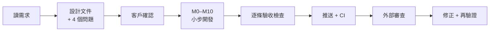
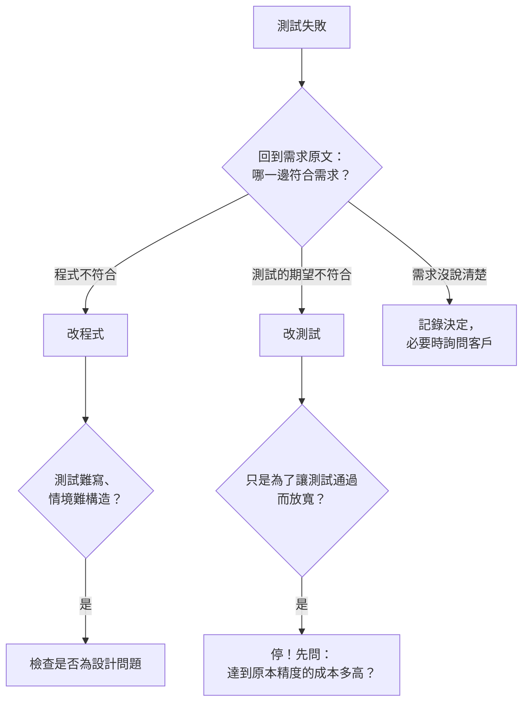

# 第 7 章　開發流程與反思：實際上是怎麼做出來的

> **本章目標**
> 1. 看一個中型專案如何切成**每一步都能編譯、都能測試**的小里程碑
> 2. 從真實踩過的坑學習：每個 bug 是**怎麼被抓到的**，比 bug 本身更有教育意義
> 3. 學會一個關鍵判斷：測試失敗時，**該改程式還是該改測試？**
> 4. 學會處理外部審查意見：哪些要改、哪些維持、怎麼回覆

---

## 7.1 流程總覽



本專案嚴格遵守一個原則：**討論完才開發**。第一步只產出設計文件與四個問題（第 1 章 1.5 節），客戶回覆「照建議」後才開始寫程式。

## 7.2 里程碑：由內而外

| 里程碑 | 內容 | 為什麼排在這裡 |
|---|---|---|
| M0 | Solution 骨架、分層架構測試、CI 設定 | 先確定骨架與規則，之後每一步都在規則內 |
| M1 | 儒略日、GMST、TLE 解析與格式化、目錄規則 | 最底層、沒有依賴，而且所有東西都要用到 |
| M2 | SGP4 + 參考資料 | 風險最高的部分，**越早驗證越好** |
| M3 | 座標轉換、太陽、陰影 | 依賴 M1、M2 |
| M4 | 暴力參考解 → 過境搜尋 | **先寫預言，再寫被測物** |
| M5 | 都卜勒、可目視、平行預報、效能 | 有了單顆衛星的搜尋，才能談平行 |
| M6 | SQLite、設定檔 | 與計算無關，可以獨立做 |
| M7 | 天空圖、時間軸幾何、CSV | 純計算，App 之前就能測 |
| M8 | 所有 Presenter | 有了 Core 與 Data，才能協調 |
| M9 | App（Silk.NET + ImGui） | **最後**才做畫面——到這時邏輯已經全部測過 |
| M10 | 範例資料、手算範例、README、截圖 | 交付物 |

兩個值得注意的排序決策：

- **風險最高的 SGP4 排在第二**：如果 SGP4 做不到 1e-6 km 的精度，整個專案就要重新評估。這種事要在第二週知道，不是第十週
- **畫面排在最後**：到 M9 時，App 只是「把已經測好的東西畫出來」。整個 App 從開始到可以截圖，只花了很短的時間

每個里程碑都是一個（或幾個）commit，每個 commit 都能編譯、所有測試都通過。commit 訊息說明**為什麼**，而不只是做了什麼：

```
M1a: 兩段式儒略日、GMST 與 Vector3d

單一 double 儒略日解析度約 40 µs，會讓 GMST 誤差超過驗收要求的 1e-9 rad，
因此 JulianDate 拆成「當日 0h」與「日內比例」兩段，與 Vallado / python-sgp4 一致。
```

## 7.3 TDD 的實際樣貌

每個功能都依「先寫測試（紅）→ 最小實作（綠）→ 整理」進行。但 TDD 在數值程式中有一個特殊之處：
**最難的不是寫實作，是取得正確的期望值**。所以本專案的實際順序常常是：

1. 寫 Python 腳本產生參考資料（取得期望值）
2. 寫 C# 測試讀取參考資料（紅：型別還不存在，編譯失敗）
3. 實作（綠）
4. 補上性質測試與構造案例

SGP4 是一個極端的例子：測試先寫好，逐行移植約 500 行後執行——**一次就全部通過**。
這不是運氣，而是「逐行移植、保留運算順序」這個策略的直接結果（第 4 章 4.3 節）。

## 7.4 真實踩過的坑

下面每一個都真實發生過。重點不是 bug 本身，而是**它是怎麼被抓到的**，以及**修的是程式還是測試**。

### 坑 1：參考資料產生器自己有 bug，被被測程式抓到

產生範例 TLE 的 Python 腳本把第 2 行的圈號欄寫成 6 個字元（應為 5），整行變成 70 字元。
C# 的 TLE 解析器正確地拒絕了它，並回報：「第 45 行：行長度應為 69 字元，實際為 70」。

> **教訓**：參考資料也會錯。被測程式的**驗證邏輯**可以反過來保護測試資料。修的是**產生器**。

### 坑 2：自己寫的邊界案例與定義衝突

陰影的單元測試有一個案例：衛星在 (0, 6000, 0)、太陽在 (1, 0, 0)。依需求的定義，r·ŝ = 0 不滿足「r·ŝ < 0」，**不在陰影內**。
但程式用來求根的連續函數 m 在這一點是負的（因為 |r| = 6000 < 地球半徑），被判為陰影。

分析後發現：這個點在**地球內部**，現實中不可能出現，但「判定是否在陰影內」這個公開函數應該忠於定義。
修正方式是把「判定」與「求根用的連續函數」分開：判定照定義寫，連續函數只用於求根。

> **教訓**：邊界案例常常揭露「兩個概念被混在一起」。修的是**程式**（拆開兩個職責）。

### 坑 3：斷言太嚴，但不應該放寬

都卜勒測試斷言「頻移為零的時刻，距離變化率 < 1e-6 km/s」，結果失敗了。原因是求根的時間容差 1e-4 秒，而變化率在過頂時每秒變化約 0.1 km/s，所以誤差可達 1e-5。

有兩個選擇：放寬斷言，或收緊求根容差。求根多做幾次二分的成本可以忽略，所以**收緊了程式的容差**（改為 1e-6 秒）。

> **教訓**：測試失敗時，先問「需求要的精度是什麼？達到它的成本多高？」。如果成本很低，改程式而不是放寬測試。

### 坑 4：測試的期望值寫錯了

晝夜分類的測試期望「太陽仰角恰為 −6° 時屬於航海曙暮光」，但程式判為民用曙暮光。
回頭看需求：可目視的條件是「太陽仰角 **<** −6°」，所以恰為 −6° 時**不可目視**，應該仍屬民用曙暮光。程式是對的。

> **教訓**：修的是**測試**。判斷依據是需求，不是「誰先寫的」。

### 坑 5：健全性檢查的門檻設錯

過境比對測試除了逐案比對，還加了一個健全性檢查：「參考解的過境總數 > 300」，確保比對不是空轉。結果失敗了：實際 289 個。
但需求要求的是「至少 300 組**隨機情境**」（我們有 320 組），不是「300 個**過境**」。是我把兩者混淆了。

> **教訓**：健全性檢查本身也要對應到需求。修的是**測試**（門檻改為 200，並註明它的目的）。

### 坑 6：測試揭露了設計缺陷

即時追蹤的測試流程是「設定衛星 → 等背景工作完成 → 讀數」，結果讀數中沒有下一次過境。
原因：過境快取要等**第一次 `Tick()`** 才開始計算，所以「等背景工作完成」其實什麼都沒等到。

這不只是測試的問題：對使用者來說，切換衛星後要等一秒才開始算，也是不好的體驗。修正為**設定衛星時立即開始計算**。

> **教訓**：難寫的測試常常代表難用的設計。修的是**程式**。

### 坑 7：只在真實執行時才看得到的問題

App 的第一次截圖揭露了一串問題，全部是單元測試抓不到的：

| 問題 | 原因 | 修正 |
|---|---|---|
| 關閉視窗時崩潰 | 在 OpenGL context 已銷毀後才釋放 GPU 資源 | 改在視窗 `Closing` 事件中釋放 |
| `≥`、`■` 顯示成 `?` | ImGui 的中文字集不含這些符號 | 自訂字集補上 |
| 過境表欄位被擠成 `2026-1(` | 表格第一次繪製時沒有資料，自動欄寬被鎖在標題寬度 | 明確指定欄寬 |
| 拖曳遮罩滑桿時一直重新預報 | 每一幀都儲存設定 | 放開滑桿才套用 |
| 截圖露出使用者的資料夾路徑 | 匯出路徑預設為「文件」資料夾 | 截圖模式改用中性路徑 |
| repo 多了 `imgui.ini` | ImGui 預設寫出版面設定檔 | 停用並加入 `.gitignore` |

> **教訓**：自動化測試不能取代**實際執行**。本專案為此加了 `--screenshot` 模式，讓「實際執行並檢視畫面」變成可重複的步驟。

### 坑 8：量測工具本身的副作用

零配置測試量到 40 bytes。原因是測試在取得「之前」的計數後才 `new Stopwatch()`——量到的是量測工具自己（第 6 章 6.9 節）。

> **教訓**：量測會干擾被量測的對象。修的是**測試**。

## 7.5 驗收檢查：逐條對照的價值

所有功能完成、384 個測試全綠之後，我們做了一次**逐條對照需求與限制條件**的檢查，結果仍然發現四個問題：

| 發現 | 為什麼之前沒抓到 |
|---|---|
| 資料庫以 `DateTime.UtcNow` 記錄匯入時刻，違反「所有現在時間透過 `TimeProvider`」 | 規則只寫在需求裡，沒有測試守著 |
| 預報耗時用 `Stopwatch` 量測 | 同上 |
| GMST、座標轉換等 5 個公開 API 以弧度為單位，違反「公開 API 角度一律以度」 | 同上；而且這些 API 名稱有標示 `Rad`，「看起來」符合規則 |
| 需求「過境表可依**時間**篩選」漏做（只做了依衛星、最大仰角） | 功能清單看起來都有，細節漏了 |

前三個問題修正後，都加上了**自動化的架構測試**（原始碼掃描、反射檢查），確保不會再犯。

> **教訓**：「測試全綠」不等於「符合需求」。測試只會檢查你想到要檢查的東西。
> 開發結束前，一定要**回到需求原文逐條對照**——這正是第 1 章「追溯表」的用途。

## 7.6 處理外部審查意見

推送後，外部審查者實際使用了程式（預報 315 個可目視過境），提出五點意見。處理方式：

| 意見 | 處理 | 理由 |
|---|---|---|
| 陰影以 10 秒取樣，短於 10 秒的擦邊地影可能漏判 | **修改**：加入導數偵測極值（第 4 章 4.6 節），並構造 1–8 秒的短陰影測試 | 確實是缺陷，而且有已知的解法（與過境搜尋同一招） |
| 不支援 Alpha-5 編號 | **修改**：支援並加 19 個測試 | NORAD 編號即將用完，是實際會發生的需求 |
| README 效能數字的前提不明 | **修改**：補充單執行緒約 2.6 秒等說明，但**措辭依實測調整** | 審查建議寫「4 核心以下可能超過 2 秒」，但實測 4 執行緒約 0.8 秒；照實測寫，並說明差異 |
| 過境搜尋依賴「30 秒內不會同時出現極大與極小」 | **維持**：README 已說明 | 對近地軌道成立；審查者的高偏心率案例也沒有問題 |
| 「起點前已開始」的過境，最大仰角取範圍內的值 | **維持** | 符合需求的定義 |

> **教訓**：審查意見不是命令，也不是攻擊。逐條判斷：**是不是真的問題？修正的成本與效益？**
> 同意就改，不同意就說明理由；部分同意（例如效能說明的措辭）就照**事實**改，並說明為什麼和建議不同。

## 7.7 判斷框架：改程式還是改測試？

把本章的案例整理成一個判斷流程：



**絕對不能做的事**：為了讓測試通過而放寬斷言或刪除測試，卻說不出「為什麼原本的斷言不合理」。

## 7.8 本章小結

- **討論完才開發**；里程碑**由內而外**、**高風險優先**、**畫面最後**
- 每個 commit 都能編譯、都通過測試；commit 訊息說明**為什麼**
- 數值程式的 TDD，最難的是**取得期望值**——先準備預言
- 每個 bug 都要問：**它是怎麼被抓到的？** 修的是程式還是測試？依據是需求
- **測試全綠 ≠ 符合需求**：結束前回到需求原文逐條對照；只寫在文件裡的規則要變成測試
- **自動化測試不能取代實際執行**
- 審查意見要**逐條判斷**，依事實回應

## 討論題

1. 本專案的里程碑把「畫面」放在最後。在什麼樣的專案中，應該**先做畫面**？（提示：需求不確定、需要使用者回饋的專案）
2. 坑 3 選擇「收緊程式容差」而不是「放寬斷言」。請舉一個相反的例子：什麼情況下放寬斷言才是正確的？
3. 驗收檢查發現的四個問題中，有三個「只寫在需求裡、沒有測試守著」。還有哪些需求的限制條件，你認為也應該寫成自動化測試？
4. 如果審查者堅持「README 應該寫 4 核心以下」，你會如何回應？
